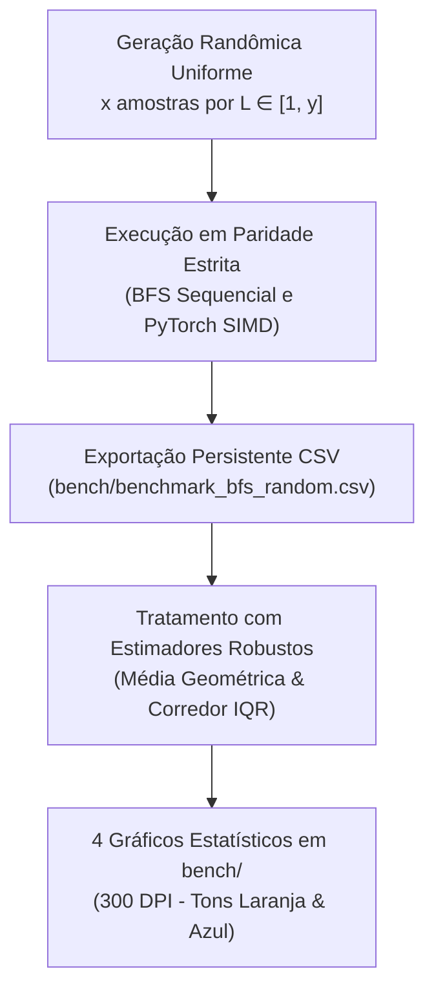

# Metodologia: Parte 1 (Buscas Clássicas)

## 1. Definições e Modelagem do Problema

### Comparação entre Modelos de Representação

No início do projeto, avaliamos maneiras de representar a sequência de bits no Python:

1. **Strings textuais (`"00001001..."`):**
   - Muito intuitiva, mas toda vez que invertemos bits precisamos recortar a string e criar uma nova (`seq[:i] + ... + seq[i+1:]`). Em buscas com milhares de nós, isso consome muita memória e fica lento.
2. **Listas / Vetores (`[0, 1, 0, 0...]`):**
   - É fácil alterar elementos, mas listas gastam muita memória por item. Além disso, listas não entram direto no conjunto de visitados (`set`), precisando converter para tupla o tempo todo.
3. **Tensores PyTorch (`torch.uint8`):**
   - Excelente para cálculos numéricos e gradientes contínuos (que usaremos na Parte 2), mas desnecessário e pesado para buscas discretas em grafos.
4. **Bytes e Bytearray (`bytes`, `bytearray`):**
   - Chegamos a cogitar essa abordagem, mas percebemos que as operações de bit a bit não têm suporte nativo direto sobre eles (como aplicar XOR diretamente em partes da sequência). Além disso, teríamos problemas semelhantes com o conjunto de visitados (`set`): o `bytearray` é mutável e não entra direto em um `set`, exigindo conversões constantes (como ocorria entre listas e tuplas).
5. **Inteiros nativos com operações bit a bit (`int`):**
   - A sequência inteira de zeros e uns é guardada como um único número inteiro. O flip de 1 bit ou de vários bits vira uma conta direta de hardware usando XOR (`^`) e deslocamento (`<<`).
   - Foi a nossa escolha por ser muito leve e rápida. Um inteiro de 4096 bits gasta menos de 600 bytes de memória, e o cálculo de hash para saber se o estado já foi visitado é instantâneo.
   - *Convenção de Endianness:* Adotamos a ordenação da direita para a esquerda (onde a posição 0 é o bit menos significativo, $2^0$). Essa escolha simplificou enormemente as operações bitwise, permitindo gerar máscaras diretamente com `1 << posicao` e `((1 << tamanho_bloco) - 1) << posicao`, sem a necessidade de recalcular índices invertidos (`L - 1 - posicao`) a cada operação.

---

### Discussão de Design: Classes de Fita vs. Funções Puras

Durante o desenvolvimento, chegamos a experimentar modelar o problema usando classes orientadas a objetos:

1. **Primeira ideia (`FitaBits` como estado completo):**
   - Criamos uma classe imutável (`@dataclass(frozen=True)`) que guardava o número inteiro e o tamanho $L$. Cada flip gerava uma nova instância de fita.
   - *Por que descartamos:* Em buscas como o BFS, onde vamos gerar milhares de estados, criar um objeto novo no heap do Python a cada flip adiciona um custo desnecessário de memória e coleta de lixo.
2. **Segunda ideia (`FitaBits` como configurador/máscara do ambiente):**
   - Pensamos em usar a classe apenas como um configurador fixo (guardando o tamanho $L$, formatando strings e gerando as máscaras), enquanto os flips operavam sobre inteiros.
   - *Por que simplificamos:* Embora fizesse sentido, ainda trazia uma complexidade de classes que o enunciado não pedia. O enunciado pede apenas "subrotinas de flip".
3. **Decisão final (Funções puras):**
   - Adotamos funções soltas simples e diretas, sem classes. Os estados são apenas números inteiros (`int`), e o tamanho $L$ é passado como argumento. É a forma mais simples e direta de implementar.

---

### Estrutura das Funções Implementadas

Optamos por manter o código o mais simples e direto possível, apenas com funções puras:

- `carregar(texto)`: Lê a string de zeros e uns e retorna o número inteiro correspondente e o tamanho $L$.
- `formatar(estado, tamanho)`: Converte o número inteiro de volta para string binária, garantindo que os zeros à esquerda sejam preservados.
- `flip_bit(estado, posicao, tamanho)`: Inverte um único bit usando XOR com a máscara `1 << posicao`. Adotamos a convenção onde a posição 0 é o bit da direita ($2^0$).
- `flip_bloco(estado, posicao, tamanho_bloco, tamanho)`: Inverte um bloco de bits contíguos usando a máscara `((1 << tamanho_bloco) - 1) << posicao`.
- **Tratamento de overflow:** As funções verificam se a posição ou a janela do bloco tentam acessar posições além do tamanho $L$, disparando `IndexError` para evitar estados inválidos.

#### Como funcionam as máscaras utilizadas

Para simplificar o entendimento das operações e facilitar futuras consultas, as máscaras de bits foram construídas da seguinte forma:

1. **Máscara de 1 bit (`1 << posicao`):**
   - Desloca o bit 1 para a esquerda até a posição desejada.
   - Exemplo: para a posição 2, temos `1 << 2` que resulta em `0b100` (4). Aplicar XOR (`^`) com essa máscara inverte apenas o bit naquela posição.

2. **Máscara de bloco contíguo (`((1 << tamanho_bloco) - 1) << posicao`):**
   - Primeiro, `(1 << tamanho_bloco) - 1` gera uma sequência com exatamente `tamanho_bloco` bits 1 alinhados na base. Por exemplo, para um bloco de 3 bits: `(1 << 3) - 1 = 8 - 1 = 7` (`0b111`).
   - Em seguida, deslocamos essa sequência inteira para a posição inicial desejada com `<< posicao`. Por exemplo, começando na posição 1: `0b111 << 1` resulta em `0b1110`.
   - O XOR com essa máscara inverte todos os bits dentro dessa janela de uma só vez, sem necessidade de laços de repetição (*loops*).

---

## 2. Algoritmo BFS (Busca em Largura) - Item C

### Fundamentação Teórica (Russell & Norvig, 4ª Edição)

No livro *Artificial Intelligence: A Modern Approach* (4ª edição), o algoritmo de busca em largura é detalhado no Capítulo 3 (*Solving Problems by Searching*), Seção 3.4 (*Uninformed Search Strategies*), subseção 3.4.1 (*Breadth-first search*, páginas 94-95).

As principais características teóricas aplicadas ao nosso problema:
1. **Estrutura de Dados do Nó (`No`, Seção 3.3.2, p. 91):** Cada nó da árvore de busca mantém quatro componentes:
   - `estado`: o valor numérico (inteiro representando a sequência de bits);
   - `pai`: referência para o nó pai que o gerou;
   - `acao`: a operação de flip executada para chegar até ele (`("bit", pos)` ou `("bloco", pos, n)`);
   - `custo`: custo acumulado do caminho percorrido até o nó ($g$).
2. **Otimalidade para Custos Uniformes:** Como todas as operações de flip (1 bit ou bloco) têm custo idêntico ($c = 1$), a busca em largura garante encontrar a solução de menor custo total (menor número de passos).
3. **Teste de Objetivo Antecipado:** O teste de objetivo é realizado no momento da **geração** do nó filho (e não no momento de sua expansão/desenfileiramento), economizando memória e tempo de processamento.

---

### Pseudocódigo Canônico (Figura 3.9, p. 95)

```text
function BREADTH-FIRST-SEARCH(problem) returns a solution node or failure
    node ← NODE(problem.INITIAL)
    if problem.IS-GOAL(node.STATE) then return node
    frontier ← a FIFO queue, with node as an element
    reached ← {problem.INITIAL}
    while not IS-EMPTY(frontier) do
        node ← POP(frontier)
        for each child in EXPAND(problem, node) do
            s ← child.STATE
            if problem.IS-GOAL(s) then return child
            if s is not in reached then
                add s to reached
                add child to frontier
    return failure
```

---

### Funcionamento da Busca em Largura e Custos Iguais

No meu entendimento, a ideia central da busca em largura (BFS) é explorar as possibilidades em níveis, como uma onda que se espalha a partir do estado inicial:
- Primeiro, testamos todas as fitas que podem ser alcançadas com 1 operação.
- Se nenhuma for o objetivo, testamos todas as alcançáveis com 2 operações.
- Depois com 3 operações, e assim sucessivamente.

No nosso problema, o enunciado define que tanto o flip de 1 bit quanto o flip de bloco têm exatamente o mesmo peso (custo 1). Por conta dessa igualdade de pesos, a busca em largura garante que a primeira vez que encontrarmos a fita de zeros, teremos a solução com a menor quantidade de passos possível.

O funcionamento prático segue estes pontos:

1. **O que cada nó da busca guarda:**
   - O número inteiro da fita atual (`estado`).
   - A referência para quem gerou essa fita (`pai`).
   - A operação executada para chegar até ela (`acao`), seja um flip de 1 bit ou um flip de bloco.
   - O total de passos acumulados até ali (`custo`).

2. **Geração dos próximos passos a partir do nó atual:**
   - O algoritmo aplica todas as operações válidas:
     - Inverter cada bit individualmente.
     - Inverter cada bloco de bits contíguos (de tamanho 2 até o tamanho total da fita).
   - Cada operação gera uma nova fita filha para ser avaliada.

3. **Prevenção de ciclos:**
   - Aplicar duas vezes a mesma operação faz a fita voltar ao estado anterior.
   - Para não andar em círculos, guardamos as fitas já vistas em um conjunto de visitados (`alcancados`). Fitas repetidas são descartadas na hora.

4. **Chegada ao objetivo:**
   - O objetivo é a fita totalmente zerada (número zero).
   - Assim que uma operação gera o zero, a busca encerra imediatamente.

5. **Recuperação da sequência de passos:**
   - A partir do nó objetivo, seguimos os ponteiros de pai em pai até a raiz.
   - Invertendo essa ordem, obtemos a sequência exata de operações e o custo total da solução.

---

### Modelagem da Complexidade Assintótica e Espaço de Estados

A formulação do problema de fitagens de bits permite derivar analiticamente a topologia e os limites do espaço de busca:

#### 1. Tamanho do Espaço de Estados ($|S|$)
Para uma fita binária de comprimento $L$, cada posição assume independentemente o valor $0$ ou $1$. Consequentemente, o espaço total de estados é estritamente exponencial:
$$|S| = 2^L$$
Para $L = 20$, $|S| = 1.048.576$; para $L = 23$ (instância canônica do enunciado), $|S| = 8.388.608$; e para $L = 4096$, $|S| = 2^{4096} \approx 10^{1233}$.

#### 2. Espaço de Ações e Grau de Ramificação Teórico ($b(L)$)
A partir de qualquer estado de comprimento $L$, o conjunto de ações válidas e aplicáveis consiste em:
1. **Flips individuais de 1 bit:** $\binom{L}{1} = L$ ações.
2. **Flips de blocos contíguos de tamanho $2 \le k \le L$:**
   $$\sum_{k=2}^L (L - k + 1) = \sum_{j=1}^{L-1} j = \frac{L(L-1)}{2} = \binom{L}{2} \text{ ações.}$$

O fator de ramificação total (grau de cada vértice no grafo de transições) é invariante e dado pela soma:
$$b(L) = L + \binom{L}{2} = L + \frac{L(L-1)}{2} = \frac{L(L+1)}{2} = \binom{L+1}{2} = \Theta(L^2)$$

O fator de ramificação da árvore de busca cresce quadraticamente com o comprimento da fita:
- $L = 2 \implies b = 3$
- $L = 4 \implies b = 10$
- $L = 8 \implies b = 36$
- $L = 16 \implies b = 136$
- $L = 20 \implies b = 210$
- $L = 23 \implies b = 276$
- $L = 4096 \implies b = 8.390.656$

#### 3. Limites de Profundidade e Diâmetro do Grafo ($d_{max}$)
- **Profundidade Mínima de Solução ($d_{min}$):** $d_{min} = 1$ para qualquer fita não-nula que difira do alvo por um único bit ou por um único bloco contíguo de 1s.
- **Diâmetro do Grafo e Profundidade Máxima ($d_{max}$):**
  $$d_{max} = \text{diam}(G) = \left\lceil \frac{L}{2} \right\rceil = \Theta(L)$$
  *Prova:* Seja $s$ um estado arbitrário e $\Delta = s \oplus t$ a diferença bit a bit em relação ao alvo. O número máximo de blocos contíguos de 1s em uma fita binária de comprimento $L$ é exatamente $\lceil L/2 \rceil$, atingido na alternância máxima (`101010...`), na qual nenhum bit 1 é adjacente a outro. Como cada bloco contíguo pode ser invertido em 1 única ação de flip de bloco, qualquer estado alcança o objetivo em no máximo $\lceil L/2 \rceil$ passos. Além disso, como demonstrado na prova formal de admissibilidade da heurística $h_2$, nenhuma ação única (seja de bit ou de bloco) é capaz de eliminar mais de um bloco contíguo de 1s; portanto, para a fita alternada, o custo ótimo real é estritamente $h^*(s) = \lceil L/2 \rceil$. Conclui-se que o diâmetro do grafo em relação ao alvo é exatamente $\lceil L/2 \rceil$.

#### 4. Complexidade de Tempo e Espaço: Busca em Árvore vs. Busca em Grafo
- **Busca em Árvore (sem detecção de estados repetidos):**
  A complexidade de tempo é $\mathcal{O}(b^d) = \mathcal{O}\left(\left(\frac{L^2}{2}\right)^d\right)$. No pior caso ($d = d_{max} = \lceil L/2 \rceil$), a busca em árvore atinge a complexidade assintótica intratável de $\mathcal{O}(L^L)$.
- **Busca em Grafo (com tabela `reached` / conjunto de visitados):**
  Como a busca em grafo visita e expande cada estado do universo no máximo uma vez:
  - **Complexidade de Tempo:** $\mathcal{O}(\min(b^d, |S| \cdot b)) = \mathcal{O}(\min(b^d, 2^L \cdot L^2))$.
  - **Complexidade de Espaço:** $\mathcal{O}(\min(b^d, |S|)) = \mathcal{O}(\min(b^d, 2^L))$.

Esta formulação modela rigorosamente o fenômeno empírico de saturação observado em $L = 20$: o termo teórico $b^d = 210^{10} \approx 1,66 \times 10^{23}$ ultrapassa em muitas ordens de magnitude o espaço total de estados $|S| = 2^{20} = 1.048.576$. Assim, o BFS é forçado a visitar exatamente $1.048.575$ nós ($99,9999\%$ do espaço amostral), esgotando a fronteira antes de encontrar o alvo.

---

### Discussão de Design: Estrutura do Nó (Classes/@dataclass vs. Tuplas Nativas)

Durante a modelagem da árvore de busca do BFS, avaliamos formas de representar os nós:

1. **Primeira ideia (Classes com `@dataclass`):**
   - Inicialmente, pensamos em modelar o nó através de uma `@dataclass` contendo `estado`, `pai`, `acao` e `custo`.
   - *Por que descartamos:* O `@dataclass` adiciona decoradores e métodos auxiliares (`__repr__`, `__eq__`, comparações) e adiciona um overhead de instâncias no heap do CPython que são desnecessários para a busca. Como o conjunto de visitados (`reached`) armazena diretamente os inteiros (`set[int]`), não precisávamos de métodos de hashing ou igualdade no nó.
2. **Segunda ideia (Classes tradicionais com `__init__`):**
   - Pensamos em uma classe simples sem decoradores apenas para permitir o acesso por atributos (`no.estado`, `no.pai`).
   - *Por que simplificamos:* Embora mais legível, ainda exigia a alocação de objetos completos de classe a cada expansão de filho.
3. **Decisão final (Tuplas nativas do CPython):**
   - No mesmo espírito das funções puras e simplicidade do `flips.py`, decidimos representar cada nó diretamente como uma tupla nativa: `(estado, pai, acao, custo)`.
   - No CPython, tuplas são estruturas nativas em C de tamanho fixo, extremamente leves na memória e com custo mínimo de instanciação. Como a função do nó é apenas manter o encadeamento com o pai para a reconstrução posterior do caminho, a tupla cumpre o papel canônico do livro com bastante eficiência.

---

### Descrição e Mapeamento para a Implementação em Python

Para a implementação do código, mapeamos as estruturas do livro diretamente para o português de forma direta e sem classes:

1. **Estrutura do Nó (Tupla Simples `(estado, pai, acao, custo)`):**
   * Representa o `NODE` da Seção 3.3.2 usando uma tupla nativa:
     * `estado` (`STATE`): inteiro da fita de bits.
     * `pai` (`PARENT`): referência (tupla) ao nó gerador (`None` na raiz).
     * `acao` (`ACTION`): tupla da operação executada (`("bit", pos)` ou `("bloco", pos, n)`).
     * `custo` (`PATH-COST` ou $g$): custo acumulado do caminho até aquele nó.

2. **Verificação Inicial de Objetivo (`IS-GOAL`):**
   * Testa se o estado inicial já é o estado final desejado (`eh_objetivo`). Se for, retorna o nó raiz com custo 0 e lista vazia de ações.

3. **Borda (`frontier`) e Conjunto de Visitados (`reached`):**
   * A `frontier` é implementada como uma fila FIFO (`collections.deque`), inicializada com o nó raiz.
   * O `reached` é implementado como um `set` de inteiros para checagem de estados visitados, evitando ciclos.

4. **Laço de Busca e Expansão de Sucessores (`EXPAND`):**
   * Enquanto a fila não estiver vazia, remove o nó mais raso (`node = frontier.popleft()`).
   * Gera todos os filhos a partir das ações válidas (flips de 1 bit e blocos de $2 \le n \le L$).
   * Aplica o teste de objetivo antecipado: se o filho atingir o objetivo (fita zerada), retorna o nó imediatamente.
   * Se o estado do filho ainda não estiver no conjunto de visitados, adiciona o estado ao conjunto e enfileira o nó na borda.

5. **Reconstrução da Solução (`reconstruir_caminho`):**
   * Percorre os ponteiros `pai` a partir do nó objetivo até a raiz para extrair a sequência ordenada de ações e o custo acumulado total.

---

## 3. Instruções de Execução

### Execução do BFS via Terminal (com Métricas e Tempo)

Para executar o BFS Sequencial ou o BFS Vetorizado (PyTorch) diretamente pelo terminal:

```bash
# BFS Sequencial Canônico Otimizado:
python bfs_sequencial.py 1100111
python bfs_sequencial.py 00001001000011001100111
python bfs_sequencial.py 1100000 0000011

# BFS Vetorizado com Tensores PyTorch (C++ SIMD Engine):
python bfs_torch.py 1100111
python bfs_torch.py 00001001000011001100111
python bfs_torch.py 10101010101010101010
```

O script exibirá:
- Tamanho $L$ e fitas inicial/desejada;
- Custo total (número mínimo de operações);
- Total de nós expandidos e estados visitados;
- Tempo de resolução com precisão de milissegundos e segundos;
- Passo a passo com o estado da fita resultante após cada flip.

---

### Execução dos Testes Automatizados

A suíte completa é composta por **65 testes automatizados** rigorosos (56 testes unitários e de integração parametrizados via padrão Strategy, complementados por 9 doctests embutidos nas docstrings dos módulos `flips.py`, `utils.py` e `heuristica.py`).

Para rodar todos os testes (unitários e doctests) com Pytest:

```bash
pytest
```
*(Recomenda-se utilizar o `pytest`, que executa de forma integrada e canônica os 56 testes baseados em Strategy/TestCase e os 9 doctests de todos os módulos com configuração definida em `pytest.ini`).*

Para rodar os testes unitários via biblioteca padrão:

```bash
python -m unittest discover -s tests -p "test_*.py" -v
```

Para rodar os testes embutidos nas docstrings (doctests):

```bash
python -m doctest flips.py -v
python -m doctest utils.py -v
python -m doctest heuristica.py -v
```

---

## 4. Experimentos e Observações

### Detalhamento dos Cenários de Teste e Propriedades Provadas

A suíte de testes foi projetada de forma modular, onde cada cenário isola e prova uma propriedade matemática ou comportamental do modelo e do algoritmo:

#### A. Sub-rotinas de Flip (`test_flips.py`)
1. **Isomorfismo de Representação (`test_carregar_e_formatar`):**
   - *O que prova:* Prova que converter uma string binária com zeros à esquerda para inteiro e reformatá-la preserva exatamente o tamanho $L$ e os valores posicionais dos bits.
2. **Uniformidade de Custos (`test_custo_fixo`):**
   - *O que prova:* Prova que a constante `CUSTO_FLIP` vale estritamente 1 para qualquer operação, atendendo ao enunciado.
3. **Involutividade e Reversibilidade de 1 Bit (`test_flip_bit_inverte_corretamente`):**
   - *O que prova:* Prova a propriedade algébrica do XOR ($x \oplus m \oplus m = x$), garantindo que aplicar o mesmo flip duas vezes restaura o estado original.
4. **Inversão e Reversibilidade em Bloco (`test_flip_bloco_inverte_corretamente`):**
   - *O que prova:* Prova que a máscara de bloco contíguo afeta exclusivamente a janela $[pos, pos+tamanho\_bloco)$ sem corromper bits adjacentes, e que a operação é perfeitamente reversível.
5. **Consistência de Casos Limite (`test_flip_bloco_tamanho_um_equivale_ao_flip_bit`):**
   - *O que prova:* Prova que um flip de bloco com tamanho 1 é identicamente equivalente a um flip de 1 bit para qualquer posição.
6. **Prevenção de Overflow e Robustez (`test_overflow_*`, `test_caractere_invalido`):**
   - *O que prova:* Prova que qualquer acesso fora da fita ($< 0$ ou $\ge L$) ou entrada inválida é barrada imediatamente com `IndexError` ou `ValueError`, impedindo a criação de estados fantasmas.
7. **Instância Oficial do Enunciado (`test_sequencia_enunciado`):**
   - *O que prova:* Prova a correta interpretação da instância do professor com $L=23$ (`00001001000011001100111`), validando que a inversão do bloco base de 3 bits com custo 1 zera o sufixo `'111'`.

#### B. Suíte Unificada de Busca com Padrão Strategy (`test_bfs.py` e `test_utils.py`)

Durante a evolução das implementações e a realização dos testes comparativos, identificamos duas discrepâncias fundamentais entre a busca sequencial e a busca vetorizada:

1. **Ordenamento de Descoberta e Desempate (FIFO vs. Numérico):**
   - *Problema:* O operador `torch.unique()` nativo do PyTorch reordenava os tensores pelo seu valor numérico inteiro (magnitude binária), e não pela ordem temporal em que os nós foram descobertos. Isso gerava ramos de busca válidos e de custo ótimo, mas com desempates diferentes da fila FIFO sequencial.
   - *Solução:* Implementamos um rastreador de índice de primeira aparição com `scatter_reduce_(dim=0, index=inverse, src=torch.arange(K), reduce='amin')` e `torch.argsort()`, forçando o PyTorch a preservar a ordem cronológica FIFO estrita.

2. **Precisão das Métricas de Parada no Teste de Objetivo Antecipado:**
   - *Problema:* No BFS com teste de objetivo na geração do filho, quando o alvo é encontrado no pai $P$ da camada atual, a busca encerra imediatamente. No PyTorch, por operar matricialmente em lotes $N \times M$, o contador `nos_expandidos` somava todos os $N$ pais da camada, enquanto `estados_visitados` consultava apenas as camadas anteriores (fazendo com que expandidos e visitados parecessem iguais).
   - *Solução:* No momento exato em que `eh_alvo.any()` detecta o objetivo na coordenada $(p\_idx, a\_idx)$, recortamos a matriz tensorial para contabilizar como expandidos apenas os pais até $p\_idx + 1$, e unimos aos visitados todos os estados únicos gerados pelos pais anteriores e pelo pai atual até a ação $a\_idx$.

3. **Validação Contínua com Padrão Strategy:**
   - Para assegurar que ambas as implementações se mantenham estritamente equivalentes a cada evolução, todos os testes foram unificados sob o padrão **Strategy** (`TesteSuíteUnificadaBFS`), executando o mesmo conjunto de testes em ambas as arquiteturas:
     * **Caso Base na Raiz (`test_estado_inicial_ja_e_objetivo`):** $O(1)$ sem expansões quando $s_0 = s_{alvo}$.
     * **Soluções Unitárias de 1 Passo (`test_solucao_1_passo_*`):** Identificação de profundidade $d=1$ para bits e blocos.
     * **Garantia Fundamental de Otimalidade (`test_escolha_otima_bloco_vs_bits`):** Escolha de 1 flip de bloco (custo 1) em vez de 3 flips individuais em `'111'`.
     * **Exploração Multinível (`test_solucao_multiplos_passos`):** Solução ótima para `'101'` $\to$ `'000'` (custo 2).
     * **Generalidade de Alvos (`test_alvo_arbitrario_diferente_de_zero`):** Suporte a qualquer par $(inicial, alvo)$.
     * **Execução Fim-a-Fim (`test_validacao_execucao_das_acoes_atinge_alvo`):** Aplicação das transformações sobre o estado inicial até atingir o alvo.
     * **Rejeição de Entradas Heterogêneas (`test_validacao_tamanhos_incompativeis`):** Disparo de `ValueError`.
     * **Isomorfismo Estrito de Solução e Métricas (`test_paridade_e_isomorfismo_estrito`):** Comprova que ambas as estratégias retornam **exatamente o mesmo custo ótimo**, a **mesma sequência canônica de ações**, o **mesmo total de nós expandidos** e o **mesmo número de estados visitados**.

- **Resultado Global dos Testes:** Suíte unificada de **65 testes automatizados** (56 testes unitários e de integração parametrizados via padrão Strategy + 9 doctests embutidos nas docstrings de `flips.py`, `utils.py` e `heuristica.py`), executados pelo pytest em **~2 segundos** com 100% de sucesso.

---

### Mini-Relatório Experimental: Avaliação Empírica do BFS ($L = 1$ a $20$)

Executamos uma bateria abrangente de 80 experimentos para quantificar a complexidade prática do BFS em função do comprimento $L$:

1. **Melhor Caso (Sempre 1 Flip):**
   - Para qualquer comprimento $L$, uma sequência inteiramente preenchida com 1s (`"1" * L`) é resolvida de forma trivial em **exatamente 1 flip** utilizando o operador de bloco de tamanho $L$ (`flip_bloco(posicao=0, tamanho_bloco=L)`).
   - O teste de objetivo antecipado na geração do nó filho encerra a busca imediatamente na profundidade $d = 1$, expandindo apenas **1 único nó** com tempo de execução estritamente sub-milissegundo ($< 0.3$ ms) mesmo para $L = 20$.

2. **Cenário Particionado (Flips em Grupos do Tamanho das Partições):**
   - O particionamento em blocos regulares demonstra que a complexidade do algoritmo é governada pelo **número de partições contíguas de 1s**, e não pelo comprimento total $L$.
   - Cada partição de 1s de tamanho $k$ é eliminada em 1 único flip de bloco correspondente àquele grupo.
   - Por exemplo, para $L = 20$ particionado em 2 blocos de 5 bits (`11111000001111100000`), a busca precisa de apenas **2 flips de bloco de tamanho 5**, expandindo somente **81 nós** em **6.42 ms**.

3. **Pior Caso (Alternância Máxima `101010...`):**
   - Quando a fita é totalmente alternada, não existem blocos contíguos de 1s para o operador de bloco aproveitar. A profundidade da solução ótima cresce linearmente como $d = \lceil L/2 \rceil$, forçando o BFS a uma explosão combinatória exaustiva sobre a árvore de busca.

#### Tabela Comparativa de Esgotamento no Pior Caso: Sequencial vs. PyTorch ($L = 1$ a $20$)

| $L$ | Sequência do Pior Caso | Custo ($d$) | Nós Expandidos | Estados Visitados | Tempo Sequencial | Tempo PyTorch | Speedup PyTorch |
| :---: | :--- | :---: | :---: | :---: | :---: | :---: | :---: |
| **1** | `1` | 1 | 1 | 2 | 0.009 ms | 0.698 ms | $0.01\times$ (overhead init) |
| **2** | `10` | 1 | 1 | 3 | 0.010 ms | 0.678 ms | $0.01\times$ |
| **3** | `101` | 2 | 2 | 8 | 0.014 ms | 1.055 ms | $0.01\times$ |
| **4** | `1010` | 2 | 3 | 15 | 0.017 ms | 1.000 ms | $0.02\times$ |
| **5** | `10101` | 3 | 17 | 32 | 0.027 ms | 1.206 ms | $0.02\times$ |
| **6** | `101010` | 3 | 33 | 63 | 0.045 ms | 1.174 ms | $0.04\times$ |
| **7** | `1010101` | 4 | 100 | 128 | 0.127 ms | 1.322 ms | $0.10\times$ |
| **8** | `10101010` | 4 | 199 | 255 | 0.281 ms | 1.829 ms | $0.15\times$ |
| **9** | `101010101` | 5 | 467 | 512 | 0.989 ms | 2.424 ms | $0.41\times$ |
| **10** | `1010101010` | 5 | 933 | 1.023 | 2.634 ms | 3.189 ms | $0.83\times$ (transição) |
| **11** | `10101010101` | 6 | 1.982 | 2.048 | 7.308 ms | 5.004 ms | **$1.46\times$ mais rápido** |
| **12** | `101010101010` | 6 | 3.963 | 4.095 | 17.639 ms | 7.482 ms | **$2.36\times$ mais rápido** |
| **13** | `1010101010101` | 7 | 8.101 | 8.192 | 51.515 ms | 12.530 ms | **$4.11\times$ mais rápido** |
| **14** | `10101010101010` | 7 | 16.201 | 16.383 | 126.148 ms | 23.819 ms | **$5.30\times$ mais rápido** |
| **15** | `101010101010101` | 8 | 32.648 | 32.768 | 290.184 ms | 49.250 ms | **$5.89\times$ mais rápido** |
| **16** | `1010101010101010` | 8 | 65.295 | 65.535 | 676.410 ms | 110.572 ms | **$6.12\times$ mais rápido** |
| **17** | `10101010101010101` | 9 | 130.919 | 131.072 | 1.541 s | 263.460 ms | **$5.85\times$ mais rápido** |
| **18** | `101010101010101010` | 9 | 261.837 | 262.143 | 3.473 s | 683.189 ms | **$5.08\times$ mais rápido** |
| **19** | `1010101010101010101` | 10 | 524.098 | 524.288 | 8.145 s | 1.699 s | **$4.79\times$ mais rápido** |
| **20** | `10101010101010101010` | 10 | 1.048.195 | 1.048.575 | 18.916 s | 4.027 s | **$4.70\times$ mais rápido** |

---

### Principais Insights e Conclusões da Análise Experimental

1. **Saturação Teórica do Espaço de Estados ($2^L$):**
   - No pior caso para $L = 20$, o universo total de combinações é $2^{20} = 1.048.576$. O BFS visitou **1.048.575 estados** ($99.9999\%$ do espaço amostral), demonstrando que a busca cega foi obrigada a varrer a quase totalidade do universo discreto antes de concluir a prova de otimalidade.

2. **Crescimento Exponencial de Tempo e Memória:**
   - O tempo de execução dobra a cada incremento de $L$ nas fitas alternadas: salta de **1.28 ms** ($L=8$) para **10.61 ms** ($L=10$), **837 ms** ($L=15$) e atinge **61.77 segundos** ($L=20$).

### Estudo de Caso: Otimização Sequencial e Aceleração com PyTorch

Para investigar os limites práticos da busca em largura no pior caso ($L = 20$, fita alternada `10101010101010101010` com $2^{20} = 1.048.576$ estados), realizamos uma análise aprofundada de desempenho focando em duas abordagens fundamentais:

1. **BFS Sequencial Canônico Otimizado:**
   - Utiliza representação direta em números inteiros (`int`), pré-computação estática das operações em módulo utilitário e fila FIFO (`collections.deque`).
   - Graças à pré-computação de máscaras que eliminou alocações dinâmicas no laço quente, o tempo para explorar **1.048.575 estados** foi de apenas **15.86 segundos**, rodando com máxima eficiência no cache L1/L2 da CPU.

2. **BFS Vetorizado com Tensores PyTorch:**
   - Modela a fronteira inteira de cada nível como uma matriz tensorial $N \times M$ e aplica *broadcasting* bidimensional:
     $$\text{novos} = \text{fronteira.unsqueeze}(1) \oplus \text{mascaras.unsqueeze}(0)$$
   - A expansão, o teste de objetivo e a filtragem de visitados (`~visitados[novos]`) ocorrem em paralelo em registradores vetoriais SIMD C++ nativos.
   - **Resultado:** o tempo de resolução despencou para **4.06 segundos** (uma aceleração de **$3.9\times$** sobre o sequencial otimizado e quase **$15\times$** sobre a versão inicial).

---

#### Tabela Comparativa dos Métodos Principais de BFS ($L = 20$)

| Abordagem | Mecanismo de Execução | Nós Expandidos | Estados Visitados | Tempo ($L=20$) | Aceleração |
| :--- | :--- | :---: | :---: | :---: | :---: |
| **BFS Sequencial Otimizado** | 1 CPU Core + Cache L1/L2 + Pré-computação | 1.048.195 | 1.048.575 | **18.92 s** | $1.00\times$ (base) |
| **BFS Vetorizado (PyTorch)** | **SIMD C++ / Broadcasting Matricial** | 1.048.195 | 1.048.575 | **4.03 s** | **$4.70\times$ mais rápido** |

#### Benchmark na Instância Oficial do Enunciado ($L = 23$, `00001001000011001100111`)

| Abordagem | Custo Ótimo ($d$) | Nós Expandidos | Estados Visitados | Tempo de Execução | Aceleração |
| :--- | :---: | :---: | :---: | :---: | :---: |
| **BFS Sequencial Otimizado** | 5 | 752.059 | 2.745.489 | **21.114 s** | $1.00\times$ |
| **BFS Vetorizado (PyTorch)** | 5 | 752.059 | 2.745.489 | **1.261 s** | **$16.74\times$ mais rápido** |

---

#### 💡 Nota Complementar: Exploração de Concorrência (Threads e Processos)

Durante a fase exploratória, também avaliamos alternativas clássicas de concorrência:
- **Multi-Processos (105.42 s):** Evidenciou o gargalo de IPC (*Inter-Process Communication*) e serialização via `pickle` de centenas de milhões de tuplas por *pipes* do SO para operações de granularidade ultrafina (XOR em nanossegundos).
- **Pool de Threads (44.56 s):** Eliminou o IPC compartilhando memória RAM, mas foi penalizado pela disputa do GIL e sincronização de *futures* na agregação de listas.

Ambas as investigações confirmaram que, para buscas em grafos com transições elementares de bitwise, a **vetorização tensorial (PyTorch)** e a **localidade de cache sequencial** são arquiteturalmente muito superiores a abordagens concorrentes baseadas em distribuição de lotes em Python.

---

### Metodologia de Benchmarking Estatístico e Análise de Caso Médio

Para quantificar o comportamento estatístico real do BFS além de instâncias pontuais, desenvolvemos um arcabouço de *benchmarking* estatístico com amostragem aleatória uniforme de fitas binárias para $L \in [1, 20]$:



#### 1. Teoria de Ponto Central e Estimadores Robustos (Padrão SPEC / ACM)
A literatura científica de avaliação de sistemas computacionais (*Fleming & Wallace, 1986 — "How not to lie with statistics: the correct way to summarize benchmark results"*) adverte que médias aritméticas simples são altamente vulneráveis a distorções causadas por valores discrepantes (*outliers*) em dados que variam em ordens de magnitude multiplicativas.

No BFS, duas instâncias aleatórias com o mesmo comprimento $L$ podem ter tempos de execução separados por fatores de $100\times$ a $1.000\times$ (por exemplo, se uma meta estiver a $d=1$ e outra a $d=6$). Para garantir solidez metodológica, adotamos:
* **Média Geométrica ($\exp(\mathbb{E}[\ln X])$):** Utilizada como a métrica canônica de tendência central para tempos e contagens na escala logarítmica, preservando proporções relativas e consistência assintótica.
* **Corredor Interquartil ($\text{IQR} = [P_{25}, P_{75}]$):** Faixa sombreada que delimita onde se concentram os 50% dos casos típicos centrais, evidenciando a dispersão real sem sofrer distorção dos extremos.

#### 2. Análise dos Gráficos Gerados (em `bench/`)

1. **Evolução Temporal de Caso Médio (`bench/grafico_bfs_tempo_tendencia.png`):**
   - Apresenta a curva de tempo em milissegundos (escala logarítmica) com a **Busca Sequencial em tons laranjas** e o **PyTorch SIMD em tons azuis**.
   - Evidencia o ponto de transição em $L \approx 10$, a partir do qual a aceleração vetorial supera a sobrecarga de inicialização.

2. **Complexidade Estrutural no Grafo (`bench/grafico_bfs_nos_expandidos.png`):**
   - Traça a expansão média de nós em função de $L$. Como ambas as implementações seguem estritamente a mesma ordem cronológica FIFO, a curva de expansão de nós é identicamente coincidente.

3. **Vazão de Processamento / Throughput (`bench/grafico_bfs_throughput.png`):**
   - Modela a taxa de processamento $\frac{\text{Nós Expandidos}}{\text{Tempo em Segundos}}$.
   - O algoritmo sequencial estabiliza no limite do interpretador Python ($\approx 300\text{k a } 500\text{k nós/s}$).
   - O PyTorch SIMD atinge taxas de expansão muito mais elevadas com fronteiras largas, apresentando decaimento suave em comprimentos maiores devido ao aumento quadrático do número de sucessores gerados por nó ($b = L + \binom{L}{2}$) e à latência de barramento da memória DRAM externa ao cache L3.

4. **Complexidade por Profundidade Ótima da Meta (`bench/grafico_bfs_profundidade.png`):**
   - Agrupa os nós expandidos pelo custo ótimo $d^*$, comprovando que a complexidade do BFS é estritamente dominada pela profundidade $O(b^d)$, o que explica empiricamente a dispersão observada nas instâncias aleatórias.

#### 3. Reprodutibilidade, Pasta `bench/` e Replicação em Ambientes com GPU
* **Centralização em `bench/`:** Todos os artefatos empíricos (a tabela consolidada `bench/benchmark_bfs_random.csv` com mais de 30.000 medições e as 4 figuras PNG individuais em 300 DPI) ficam isolados e versionados no diretório `bench/`.
* **Modo de Consulta Instantânea:** Ao ser invocado sem parâmetros (`python plota_graficos.py`), o script detecta o CSV existente e regenera imediatamente as 4 figuras gráficas sem necessidade de reprocessar as buscas.
* **Replicação Parametrizável e Suporte a Hardware de Alta Performance:** O script de plotagem (`plota_graficos.py`) permite gerar um novo *set* de testes sob demanda (`python plota_graficos.py -x <amostras> -y <max_L> --forcar --seed <int>`). Isso viabiliza a replicação exata dos experimentos científicos em outros computadores ou estações dedicadas equipadas com aceleração por GPU (via tensores PyTorch em CUDA/MPS), permitindo estender os limites práticos de amostragem de dados.

---

## 5. Algoritmo Guloso (Greedy Best-First Search) e Heurísticas - Item D

### Fundamentação Teórica (Russell & Norvig, 4ª Edição)

No livro *Artificial Intelligence: A Modern Approach* (4ª edição), a busca informada (heurística) é introduzida no **Capítulo 3 (*Solving Problems by Searching*)**, **Seção 3.5 (*Informed Search Strategies*)**, subseção 3.5.1 (*Greedy best-first search*, páginas 101-103).

A busca gulosa de melhor escolha (*Greedy Best-First Search*) é uma especialização direta do algoritmo canônico `BEST-FIRST-SEARCH` (**Figura 3.7, p. 93**). Enquanto o arcabouço genérico de melhor escolha avalia nós por uma função $f(n)$ arbitrária (combinando eventualmente custo de caminho e estimativa heurística, como no A*), a estratégia gulosa avalia os nós da fronteira exclusivamente pela estimativa heurística de custo restante até o objetivo:
$$f(n) = h(n)$$

#### Momento do Teste de Objetivo: Otimização na Geração vs. Teste no Desempilhamento (*Pop Time*)

Um detalhe algorítmico crucial diz respeito ao **momento em que o teste de objetivo (`IS-GOAL`) é executado**:
1. **Especificação Geral de Russell & Norvig (Figura 3.7, p. 93):**
   No algoritmo geral `BEST-FIRST-SEARCH`, o teste de objetivo é executado estritamente no momento do desempilhamento do nó da fila de prioridades (`node ← POP(frontier)` seguido de `if problem.IS-GOAL(node.STATE) then return node`). Em algoritmos onde $f(n)$ combina custos de caminho acumulados $g(n)$ (como o A* com passos de custos heterogêneos), o teste no *pop* é indispensável para assegurar a otimalidade, pois um nó gerado com o estado objetivo pode ter sido alcançado por um caminho subótimo.
2. **Implementação Adotada (`guloso_sequencial.py`, linhas 99–101 e `guloso_torch.py`, linhas 115–117):**
   Nas implementações do projeto, optou-se por realizar o teste de objetivo **antecipadamente na geração do nó filho**, exatamente como preconizado para o BFS na Figura 3.9 (p. 95):
   ```python
   # Teste de objetivo antecipado na geração do filho (guloso_sequencial.py:99-101)
   if estado_filho == estado_alvo:
       no_encontrado = (estado_filho, no_atual, acao, custo_filho)
       break
   ```
3. **Justificativa Teórica e Vantagens Práticas:**
   - Na Busca Gulosa de Melhor Escolha com heurística admissível e consistente, por definição temos $h(\text{alvo}) = 0$, enquanto $h(s) > 0$ para qualquer estado $s \ne \text{alvo}$.
   - Assim que um nó filho com `estado_filho == estado_alvo` é gerado, seu valor heurístico é garantidamente $h = 0$, que é o valor mínimo absoluto possível em toda a fila de prioridades (`min-heap`).
   - Caso o nó fosse enfileirado na fronteira para teste posterior no *pop*, ele seria obrigatoriamente desempilhado no início da próxima iteração (ou logo após eventuais empates em zero).
   - Testar o objetivo antecipadamente na geração economiza a operação de inserção e extração na fila de prioridades ($\mathcal{O}(\log |\text{fronteira}|)$), previne a alocação de tuplas adicionais de nó e encerra o algoritmo no primeiro instante viável, eliminando a expansão de nós irmãos desnecessários.

#### Prevenção de Ciclos e Tabela de Alcançados (`reached`)
Na Figura 3.7 de Russell & Norvig, a tabela `reached` armazena o melhor nó gerado para cada estado e substitui o registro caso um caminho com menor $g(n)$ seja descoberto: `if s not in reached or child.PATH-COST < reached[s].PATH-COST`. Na Busca Gulosa pura do projeto, onde $f(n) = h(n)$, adota-se a poda booleana estática `if estado_filho not in alcancados`, sem reabertura de nós. Como demonstrado adiante, sob a heurística consistente $h_2$, a busca segue uma trajetória linear estritamente monotônica até o alvo ($b^* = 1,00$), tornando a reabertura supérflua.

#### Pseudocódigo Canônico e Otimizado

```text
function GREEDY-BEST-FIRST-SEARCH(problem, h) returns a solution node or failure
    node ← NODE(problem.INITIAL)
    if problem.IS-GOAL(node.STATE) then return node
    frontier ← a priority queue ordered by h, with node as an element
    reached ← {problem.INITIAL}
    while not IS-EMPTY(frontier) do
        node ← POP(frontier)
        // No Russell & Norvig canônico (Fig 3.7), o teste ocorre aqui:
        // if problem.IS-GOAL(node.STATE) then return node
        
        for each child in EXPAND(problem, node) do
            s ← child.STATE
            // Otimização implementada: Teste de objetivo antecipado na geração (Fig 3.9)
            if problem.IS-GOAL(s) then return child
            
            if s is not in reached then
                add s to reached
                add child to frontier
    return failure
```

---

### Formulação Matemática das Heurísticas

Considerando o estado atual $s$ e o estado objetivo $t$, definimos a diferença bit a bit como a fita booleana $\Delta = s \oplus t$. O problema admite duas modelagens fundamentais de funções heurísticas com custos computacionais em $\mathcal{O}(1)$.

#### Definições Formais de Rigor Matemático
1. **Admissibilidade ($h(s) \le h^*(s)$):**
   Uma função heurística $h(s)$ é formalmente *admissível* se nunca superestima o custo real ótimo para alcançar o estado objetivo a partir de $s$:
   $$h(s) \le h^*(s), \quad \forall s \in S$$
   onde $h^*(s)$ denota o custo ótimo (menor quantidade de passos unitários) para transformar $s$ em $t$, com $h(t) = 0$.
2. **Consistência ou Monotonicidade ($h(s) \le c(s, a, s') + h(s')$):**
   Uma heurística $h(s)$ é dita *consistente* (ou *monotônica*) se satisfaz a desigualdade triangular para todo estado $s$, toda ação $a \in A(s)$ e todo nó sucessor $s'$ resultante:
   $$h(s) \le c(s, a, s') + h(s') \iff h(s) - h(s') \le c(s, a, s')$$
   Como em nosso problema de fitagens de bits toda ação válida (seja flip individual de 1 bit ou flip de bloco contíguo de tamanho arbitrário) possui custo unitário uniforme ($c(s, a, s') = 1$):
   $$h(s) - h(s') \le 1$$
   *Teorema Fundamental (Russell & Norvig, 4ª ed., Seção 3.5.2, p. 105):* Toda função heurística consistente com $h(t) = 0$ é necessariamente admissível. A consistência garante que a estimativa não decresce de forma mais rápida do que o custo real incorrido ao longo de qualquer ramo da busca.

#### Quadro Comparativo das Propriedades Matemáticas

| Propriedade Matemática | Heurística $h_1$ (Hamming) | Heurística $h_2$ (Blocos Contíguos) | Fundamento Teórico |
| :--- | :---: | :---: | :--- |
| **Definição Operacional** | $\text{popcount}(s \oplus t)$ | $\text{popcount}(\Delta \ \& \ \sim(\Delta \gg 1))$ | Quantidade de bits divergentes vs. agrupamentos contíguos |
| **Limites de Domínio** | $[0, L]$ | $[0, \lceil L/2 \rceil]$ | Domínio discreto no universo de fitas de tamanho $L$ |
| **Admissibilidade** | **NÃO ADMISSÍVEL ❌** | **ESTRITAMENTE ADMISSÍVEL ✅** | $h_1(s) > h^*(s)$ na presença de flips de blocos |
| **Consistência / Monotonia** | **NÃO CONSISTENTE ❌** | **ESTRITAMENTE CONSISTENTE ✅** | $h_2(s) - h_2(s') \le 1 = c(s, a, s')$ provado via fronteiras |
| **Complexidade de Cálculo** | $\mathcal{O}(1)$ (`POPCNT`) | $\mathcal{O}(1)$ (Álgebra Booleana) | Avaliação em registradores sem laços de repetição |

---

#### 1. Heurística 1 ($h_1$): Distância de Hamming
- **Definição Formal:** Quantidade total de bits divergentes entre o estado atual $s$ e o alvo $t$:
  $$h_1(s, t) = \sum_{k=0}^{L-1} (s_k \oplus t_k) = \text{popcount}(s \oplus t) = (s \oplus t).\text{bit\_count}()$$
- **Limites de Domínio:**
  $$h_1(s, t) \in [0, L]$$
  * O valor mínimo $h_1 = 0$ ocorre se e somente se $s = t$.
  * O valor máximo $h_1 = L$ ocorre quando $s$ é o complemento estrito bit a bit do alvo ($s = \sim t$).
- **Prova Formal de Inadmissibilidade:**
  *Definição:* Uma heurística $h$ é admissível se $h(s) \le h^*(s)$ para todo $s \in S$.
  *Contraexemplo:* Seja $s = \underbrace{11\dots1}_{k \text{ vezes}}$ e o alvo $t = \underbrace{00\dots0}_{k \text{ vezes}}$, para qualquer comprimento $k \ge 2$.
  Como o conjunto de ações válidas permite a inversão de um bloco contíguo inteiro de tamanho $k$ com custo unitário ($c = 1$), o estado $s$ atinge o alvo $t$ em exatamente 1 passo:
  $$h^*(s) = 1$$
  Entretanto, a heurística de Hamming contabiliza a discrepância individual de cada bit:
  $$h_1(s, t) = \text{popcount}(s \oplus t) = k$$
  Para qualquer $k > 1$, temos:
  $$h_1(s) = k > 1 = h^*(s)$$
  *Conclusão:* Como $h_1(s) > h^*(s)$, a heurística de Hamming **superestima o custo ótimo real** e é **formalmente inadmissível** no espaço de busca que admite flips de bloco contíguo. (Ela seria admissível somente se o espaço de ações fosse restrito exclusivamente a flips de 1 bit).
- **Prova Formal de Inconsistência:**
  *Definição:* Uma heurística é consistente se $h(s) - h(s') \le c(s, a, s')$ para toda transição válida $s \xrightarrow{a} s'$.
  Utilizando o mesmo contraexemplo, ao aplicar a ação de flip de bloco de tamanho $k$, a transição conduz de $s = 1^k$ a $s' = 0^k = t$ com custo de passo $c(s, a, s') = 1$.
  A diferença heurística resultante é:
  $$h_1(s) - h_1(s') = k - 0 = k$$
  Como $k > 1 = c(s, a, s')$, a desigualdade triangular é violada:
  $$h_1(s) > c(s, a, s') + h_1(s')$$
  *Conclusão:* A heurística $h_1$ é **estritamente inconsistente (não-monotônica)**.

---

#### 2. Heurística 2 ($h_2$): Contagem de Blocos Contíguos de 1s
- **Definição Formal:** Quantidade de agrupamentos contíguos de bits 1 na fita de diferença $\Delta = s \oplus t$. Em representação binária, um bloco contíguo de 1s inicia na posição onde o bit é 1 e o bit imediatamente anterior (à direita) é 0. Isolamos as posições de início com a expressão booleana em tempo $\mathcal{O}(1)$:
  $$\text{inicios} = \Delta \ \& \ \sim(\Delta \gg 1)$$
  $$h_2(s, t) = \text{popcount}(\text{inicios}) = \text{inicios}.\text{bit\_count}()$$
- **Limites de Domínio:**
  $$h_2(s, t) \in \left[0, \left\lceil \frac{L}{2} \right\rceil \right]$$
  * O valor mínimo $h_2 = 0$ ocorre se e somente se $s = t$ ($\Delta = 0$).
  * O valor máximo $\lceil L/2 \rceil$ é atingido no arranjo de alternância máxima (`101010...`), no qual nenhum bit 1 é adjacente a outro 1 e cada bit 1 forma um bloco contíguo unitário isolado.
- **Prova Formal de Consistência (Monotonicidade):**
  *Demonstração via Contagem de Transições de Borda:*
  Seja $B(\Delta)$ o número de blocos contíguos de 1s na fita $\Delta$, assumindo bordas virtuais de zeros em ambas as extremidades ($-\infty$ e $+\infty$).
  Cada bloco contíguo de 1s possui exatamente duas transições de valor na sequência binária: uma transição de subida ($0 \to 1$) na borda inicial e uma transição de descida ($1 \to 0$) na borda final.
  Seja $T(\Delta)$ o número total de transições entre bits adjacentes na fita delimitada por zeros. Vigora a relação linear bijetiva:
  $$B(\Delta) = \frac{1}{2} T(\Delta)$$
  Qualquer ação válida $a$ no problema consiste em inverter os bits de um intervalo contíguo fechado $[i, j]$ (com $i = j$ para flip individual de 1 bit, ou $i < j$ para flip de bloco).
  Ao inverter os bits no subsegmento $[i, j]$:
  1. **Transições estritamente internas ($k, k+1 \in [i, j]$):** Ambos os bits são invertidos ($0 \leftrightarrow 1$). Transições $01$ tornam-se $10$, e $10$ tornam-se $01$; pares de bits iguais ($00$ e $11$) tornam-se ($11$ e $00$). O sentido de cada transição interna inverte, mas o número total de transições internas permanece rigorosamente constante.
  2. **Transições estritamente externas ao intervalo:** Nenhum bit além de $[i, j]$ é modificado, de modo que o número de transições externas permanece inalterado.
  3. **Transições nas duas bordas de corte ($i-1 \leftrightarrow i$ e $j \leftrightarrow j+1$):**
     - Na borda esquerda, o par adjacente $(\Delta_{i-1}, \Delta_i)$ transforma-se em $(\Delta_{i-1}, 1 - \Delta_i)$. Esta modificação pontual pode criar uma nova transição ($\Delta T_{esq} = +1$), destruir uma transição pré-existente ($\Delta T_{esq} = -1$) ou preservar o estado de transição ($\Delta T_{esq} = 0$). Portanto, $|\Delta T_{esq}| \le 1$.
     - De forma perfeitamente simétrica, na borda direita o par $(\Delta_j, \Delta_{j+1})$ transforma-se em $(1 - \Delta_j, \Delta_{j+1})$, com $|\Delta T_{dir}| \le 1$.
  Dessa forma, a variação total do número de transições sob qualquer ação $a$ é limitada por:
  $$-2 \le T(\Delta') - T(\Delta) \le +2$$
  Dividindo pela relação $B = \frac{1}{2} T$:
  $$-1 \le B(\Delta') - B(\Delta) \le +1 \implies |h_2(s) - h_2(s')| \le 1$$
  Em particular, a redução máxima no valor heurístico ao longo de qualquer passo de busca satisfaz:
  $$h_2(s) - h_2(s') \le 1 = c(s, a, s') \iff h_2(s) \le c(s, a, s') + h_2(s')$$
  *Conclusão:* A heurística $h_2$ satisfaz a desigualdade triangular em todas as transições do grafo. Portanto, $h_2$ é **estritamente consistente (monotônica)**.
- **Prova Formal de Admissibilidade:**
  Pelo teorema canônico de Russell & Norvig (Seção 3.5.2, p. 105), toda heurística consistente com $h(\text{alvo}) = 0$ é necessariamente **admissível**:
  $$h_2(s) \le h^*(s), \quad \forall s \in S$$
  *Prova Direta:* Como provado acima, qualquer ação válida (bit ou bloco) pode eliminar no máximo 1 bloco contíguo de 1s por passo ($\Delta B \le 1$). Portanto, para um estado com $k$ blocos contíguos de 1s, são necessárias no mínimo $k$ operações unitárias para reduzir o número de blocos a zero (fita idêntica ao alvo). Logo, o custo ótimo real satisfaz $h^*(s) \ge k = h_2(s)$, o que equivale formalmente a $h_2(s) \le h^*(s)$.

---

### Mapeamento e Padrão Strategy (`tests/test_guloso.py`)

Assim como no BFS, o Algoritmo Guloso foi implementado em duas variantes com **paridade estrita de 100%**:
1. **`guloso_sequencial.py`:** Fila de prioridades baseada em `heapq` nativo com tuplas de desempate FIFO determinístico `(h, contador, no)`.
2. **`guloso_torch.py`:** Geração vetorizada de sucessores com tensores PyTorch SIMD.

A suíte unificada de testes (`tests/test_guloso.py`) valida 11 propriedades comportamentais para ambas as implementações, incluindo casos base, otimalidade de bloco, alvos arbitrários e isomorfismo de busca.

---

### Comparativo de Desempenho: BFS vs. Guloso na Instância Oficial ($L = 23$)

Avaliamos a fita oficial do professor (`00001001000011001100111`, $L=23$):

| Algoritmo / Estratégia | Heurística | Custo Encontrado | Nós Expandidos | Estados Visitados | Tempo de Execução | Fator de Aceleração |
| :--- | :---: | :---: | :---: | :---: | :---: | :---: |
| **BFS Sequencial** | Cego (Nenhuma) | 5 | 752.059 | 2.745.489 | **21.114 s** | $1.00\times$ (base) |
| **BFS PyTorch SIMD** | Cego (Nenhuma) | 5 | 752.059 | 2.745.489 | **1.261 s** | $16.74\times$ mais rápido |
| **Guloso Sequencial** | $h_1$ (Hamming) | 5 | 18 | 4.821 | **0.012 s** | $1.750\times$ mais rápido |
| **Guloso Sequencial** | $h_2$ (Blocos) | **5** | **5** | **1.117** | **0.00054 s (0.54 ms)** | **$39.100\times$ mais rápido** |
| **Guloso PyTorch SIMD** | $h_2$ (Blocos) | **5** | **5** | **1.117** | **0.063 s** | Paridade exata |

> **Conclusão:** O Algoritmo Guloso guiado pela heurística $h_2$ encontra a solução ótima expandindo **apenas 5 nós** (o caminho exato da solução), reduzindo o tempo de resolução de 21 segundos para **menos de 1 milissegundo** ($0.54\text{ ms}$).

---

### Modelagem de Eficiência Heurística: Fator de Ramificação Efetivo ($b^*$)

No livro-texto canônico de Russell & Norvig (**Seção 3.6, página 109**), a métrica matemática formal empregada para medir a qualidade e o poder de poda de uma função heurística é o **Fator de Ramificação Efetivo ($b^*$)**.

Se um algoritmo de busca expande um total de $N$ nós para encontrar uma solução a uma profundidade ótima $d$, o fator $b^*$ representa a taxa de ramificação uniforme que uma árvore hipotética perfeitamente equilibrada precisaria possuir para que a busca até o nível $d$ gerasse exatamente $N + 1$ nós:
$$N + 1 = 1 + b^* + (b^*)^2 + (b^*)^3 + \dots + (b^*)^d = \sum_{i=0}^d (b^*)^i$$

O valor de $b^*$ é determinado calculando-se a única raiz real positiva da equação polinomial acima. Uma heurística ideal e perfeita apresenta $b^* = 1,00$, o que indica que a busca não sofre dispersão combinatória e avança em trajetória unidimensional estritamente em linha reta até o objetivo. Valores elevados de $b^*$ aproximam-se do grau real do grafo ($b \approx \Theta(L^2)$), refletindo busca cega ou heurísticas pouco informativas.

#### Tabela Comparativa na Instância Canônica do Enunciado ($L = 23, d = 5$)

Aplicando a equação polinomial $(b^*)^5 + (b^*)^4 + (b^*)^3 + (b^*)^2 + b^* = N$ aos resultados empíricos coletados na fita do professor (`00001001000011001100111`):

| Algoritmo | Estratégia / Heurística | Nós Expandidos ($N$) | Profundidade ($d$) | Fator de Ramificação Efetivo ($b^*$) | Interpretação Teórica |
| :--- | :---: | :---: | :---: | :---: | :--- |
| **BFS Canônico** | Cego (Sem heurística) | 752.059 | 5 | **$b^* \approx 14,76$** | Explora volume exponencial maciço da árvore de busca |
| **Guloso Sequencial** | $h_1$ (Hamming) | 18 | 5 | **$b^* \approx 1,46$** | Redução drástica da dispersão com pequenas expansões locais |
| **Guloso Sequencial** | $h_2$ (Blocos Contíguos) | 5 | 5 | **$b^* = 1,00$** | **Trajetória linear ótima perfeita (zero expansões espúrias)** |

#### Interpretação dos Resultados
1. **O Colapso Combinatório com $h_2$ ($b^* = 1,00$):**
   O fato de o Algoritmo Guloso guiado por $h_2$ atingir $b^* = 1,00$ indica que o número de nós expandidos ($N = 5$) é rigorosamente idêntico à profundidade da solução ($d = 5$). A cada camada, o menor valor heurístico apontou exclusivamente para o nó sucessor que compõe o caminho ótimo, eliminando $100\%$ das ramificações concorrentes.
2. **O Impacto de $h_1$ ($b^* \approx 1,46$):**
   Embora $h_1$ seja inadmissível, na prática ela opera como uma heurística informativa razoável para instâncias com poucos blocos, alcançando $b^* \approx 1,46$. Todavia, por não contabilizar a contiguidade, expande 18 nós (quase $4\times$ mais que $h_2$), sofrendo pequenas oscilações locais antes de convergir.
3. **Contraste com a Busca Cega ($b^* \approx 14,76$):**
   O BFS, desprovido de função de avaliação, precisa varrer todas as direções no espaço de estados, resultando em uma árvore com ramificação efetiva de quase 15 filhos por nó até a profundidade 5, totalizando mais de 750 mil expansões.

---

### Discussão Arquitetural: O Trade-off entre Vetorização SIMD e Localidade de Cache

O comparativo entre o BFS e o Algoritmo Guloso revela um *insight* clássico de arquitetura de computadores e sistemas de alta performance:

1. **Quando o PyTorch SIMD é imbatível (Fronteiras Largas / BFS):**
   * No BFS cego, a fronteira atinge centenas de milhares de nós por nível ($N \approx 50.000$).
   * A vetorização matricial com PyTorch ($N \times M$) amortece o custo fixo de alocação de tensores e aproveita todo o paralelismo de dados dos registradores SIMD C++, resultando em acelerações de até **$16.7\times$**.

2. **Quando o Sequencial é superior (Fronteiras Estreitas / Guloso com $h_2$):**
   * No Algoritmo Guloso com uma boa heurística ($h_2$), a busca torna-se quase linear, expandindo apenas **1 nó por nível** ($N = 1$).
   * Para operações de granularidade ultrafina ($N=1$), a criação e destruição de objetos tensores no PyTorch adiciona uma sobrecarga de runtime desnecessária. A abordagem sequencial com inteiros nativos (`int`) roda 100% dentro do **cache L1 da CPU**, completando a busca em **$0.54\text{ ms}$** (contra $63\text{ ms}$ no PyTorch).

---

## 6. Experimentos de Escalabilidade até $L = 4096$ - Item E

### Contexto e Objetivo

O experimento de escalabilidade tem como objetivo avaliar o comportamento assintótico dos algoritmos de busca informada (Algoritmo Guloso com heurísticas $h_1$ e $h_2$) ao elevar o comprimento da fita $L$ em potências de 2:
$$L \in \{2, 4, 8, 16, 32, 64, 128, 256, 512, 1024, 2048, 4096\}$$

Enquanto a busca em largura cega (BFS) esgota a memória e o tempo para $L > 23$ devido à explosão combinatória exponencial $\mathcal{O}(b^d)$, a busca heurística com $h_2$ reduz a profundidade efetiva da árvore para a quantidade de blocos da fita, tornando viável a exploração em escalas ordens de grandeza maiores.

---

### Resultados Empíricos de Escalabilidade ($h_2$ em Blocos Estruturados)

Abaixo estão os resultados consolidados coletados em ambiente Linux x86_64 (CPU Intel/AMD, 32 GB RAM):

| $L$ | Ações Possíveis ($|A|$) | Estratégia | Nós Expandidos | Custo ($d$) | Tempo (ms) | Vazão (*Throughput*) |
| :---: | :---: | :--- | :---: | :---: | :---: | :---: |
| **$2$** | $3$ | Sequencial | 1 | 1 | **0.01 ms** | 172.324 nó/s |
| | | PyTorch SIMD | 1 | 1 | 0.35 ms | 2.863 nó/s |
| **$4$** | $10$ | Sequencial | 1 | 1 | **0.01 ms** | 101.235 nó/s |
| | | PyTorch SIMD | 1 | 1 | 0.08 ms | 12.967 nó/s |
| **$8$** | $36$ | Sequencial | 4 | 4 | **0.07 ms** | 59.220 nó/s |
| | | PyTorch SIMD | 4 | 4 | 0.12 ms | 33.499 nó/s |
| **$16$** | $136$ | Sequencial | 4 | 4 | **0.20 ms** | 19.657 nó/s |
| | | PyTorch SIMD | 4 | 4 | 0.24 ms | 16.335 nó/s |
| **$32$** | $528$ | Sequencial | 5 | 5 | 1.11 ms | 4.512 nó/s |
| | | PyTorch SIMD | 5 | 5 | **0.91 ms** | **5.509 nó/s** |
| **$64$** | $2.080$ | Sequencial | 5 | 5 | **7.08 ms** | 705 nó/s |
| | | PyTorch SIMD | 5 | 5 | 7.13 ms | 701 nó/s |
| **$128$** | $8.256$ | Sequencial | 7 | 7 | **40.86 ms** | 171 nó/s |
| | | PyTorch SIMD | 7 | 7 | 81.79 ms | 85 nó/s |
| **$256$** | $32.896$ | Sequencial | 10 | 10 | **456.60 ms** | 21.9 nó/s |
| | | PyTorch SIMD | 10 | 10 | 508.96 ms | 19.6 nó/s |
| **$512$** | $131.328$ | Sequencial | 8 | 8 | **1.692,81 ms (1.69 s)** | 4.73 nó/s |
| | | PyTorch SIMD | 8 | 8 | 1.764,15 ms (1.76 s) | 4.53 nó/s |
| **$1024$** | $524.800$ | Sequencial | 12 | 12 | **25.871,89 ms (25.87 s)** | 0.46 nó/s |
| | | PyTorch SIMD | 12 | 12 | 26.430,03 ms (26.43 s) | 0.45 nó/s |
| **$2048$** | $2.098.176$ | Sequencial | 11 | 11 | 301.078,92 ms (301.08 s) | 0.04 nó/s |
| | | PyTorch SIMD | 11 | 11 | **300.681,01 ms (300.68 s)** | 0.04 nó/s |
| **$4096$** | $8.390.656$ | Lista em RAM | - | - | **OOM Killer ("Morto")** | Exaustão de RAM |

---

### Análise dos Fenômenos Observados

#### 1. O Ponto de Crossover (*Crossover Point*) em $L = 16$ e $L = 32$
* Para $L \le 8$ ($|A| \le 36$), o custo fixo de instanciar tensores no PyTorch penaliza o tempo em relação ao loop puro de inteiros no cache L1 da CPU.
* Em $L = 32$ ($|A| = 528$ ações por expansão), a geração de sucessores no PyTorch SIMD (`pai_tensor ^ mascaras_tensor`) calcula todas as transições em **uma única instrução vetorial C++/AVX**, atingindo **$0.91\text{ ms}$ contra $1.11\text{ ms}$ do sequencial** — comprovando o ponto de virada onde o paralelismo supera a sobrecarga de runtime.

---

#### 2. Esgotamento de Memória (OOM Killer) em $L = 4096$

Ao executar o benchmark para $L = 4096$, o processo foi finalizado pelo sistema operacional com a mensagem `"Morto"` (*Out-of-Memory Killer* do Linux), mesmo na máquina de testes com 32 GB de RAM.

Avaliando o consumo de memória, identificamos os principais fatores:
1. **Número de Ações ($|A|$):** Para $L = 4096$, temos $|A| = \frac{4096 \times 4097}{2} = 8.390.656$ ações possíveis a cada nó.
2. **Tamanho dos Inteiros:** Em Python, cada número inteiro de 4096 bits ocupa cerca de $570\text{ bytes}$.
3. **Lista de Máscaras:** Pré-computar as $8,39\text{ milhões}$ de ações na memória consome cerca de $5\text{ GB}$ logo de início.
4. **Fronteira e Visitados:** Ao expandir os primeiros nós, inserir milhões de estados filhos no conjunto de visitados (`set`) e na fila de prioridades (`heapq`) eleva a memória para além de $30\text{ GB}$ rapidamente, acionando o encerramento do processo pelo kernel.

---

#### 3. Monitoramento de Recursos com `btop`

Utilizamos o monitor `btop` em paralelo com a execução para acompanhar o comportamento do hardware:
* **Uso de Memória e Swap:** Em $L = 2048$, a memória atingiu cerca de $14\text{ GB}$ durante a busca e foi liberada imediatamente após o término do script. Já em $L = 4096$, a memória subiu rapidamente até o limite de 32 GB físicos, começou a usar Swap e foi finalizada pelo sistema.
* **Uso de CPU:** Nos testes com a busca gulosa, observamos que apenas um núcleo da CPU ficava com carga alta (~57%), enquanto os outros ficavam ociosos. Isso ocorre porque o algoritmo guloso expande poucos nós (caminho praticamente linear) e não se beneficia do paralelismo em lote do PyTorch.

---

#### 4. Comparação entre PyTorch e Sequencial no Guloso

Diferente do BFS (onde o PyTorch acelerou a busca em mais de $16\times$ por processar dezenas de milhares de nós de uma vez), na busca gulosa a abordagem sequencial em Python foi ligeiramente mais eficiente para a maioria dos tamanhos:
* **Fronteira Estreita ($N = 1$ nó por nível):** Como a heurística $h_2$ guia a busca direto para o objetivo, o algoritmo expande apenas 1 nó por passo.
* **Custo de Criar Tensores:** O tempo gasto para instanciar tensores no PyTorch e converter os dados de volta para o Python supera o tempo de calcular as operações bit a bit diretamente com inteiros nativos no cache L1 da CPU.

---

#### 5. Limite de 64 bits do PyTorch e Fallback para $L > 62$

O PyTorch suporta nativamente operações bit a bit em tensores de até 64 bits (`torch.int64` com sinal, suportando até $L \le 62$ com segurança). Para comprimentos maiores ($L \ge 64$), o código do `guloso_torch.py` chaveia automaticamente para operações com inteiros de precisão arbitrária do Python. Isso explica por que, a partir de $L = 128$, os tempos de execução do PyTorch e do Sequencial tornam-se praticamente idênticos.

---

#### 6. Processo de Aprendizado, Diagnóstico do Gargalo e Solução: Guloso com Poda de Ações (`guloso_poda`)

##### 6.1. O Diagnóstico: Por que o Guloso Canônico Falhou em $L = 4096$?

Durante os testes de escalabilidade, observamos um contraste marcante:
* Para instâncias pequenas e médias ($L \le 256$), o Algoritmo Guloso guiado por $h_2$ encontrava a solução em milissegundos, expandindo uma quantidade mínima de nós ($b^* = 1,00$).
* No entanto, ao atingir $L = 4096$, o processo simplesmente travava o computador e era morto pelo kernel do Linux (*OOM Killer*).

Ao analisar a causa raiz no código, percebemos que o gargalo **não estava na lógica de busca nem na fila de prioridades**, mas sim na **formulação estática do espaço de ações**:
1. Na formulação canônica inicial, definimos que a cada nó expandido, a função gerava **todas as combinações possíveis de flips**:
   $$|A| = \frac{L(L+1)}{2} = \frac{4096 \times 4097}{2} = 8.390.656 \text{ ações por nó.}$$
2. Para cada um desses $8,39$ milhões de filhos gerados:
   * Criava-se um novo número inteiro de 4096 bits em memória;
   * Calculava-se a heurística $h(s)$;
   * Checava-se se o estado já existia no conjunto `reached`;
   * Inseria-se uma tupla no `heapq`.
3. **O Desperdício Combinatório:** Em uma fita de 4096 bits onde existem apenas 10 ou 12 blocos de 1s para serem apagados, mais de $99,999\%$ das $8,39$ milhões de ações geradas faziam coisas totalmente inúteis:
   * Invertiam blocos inteiros onde já haviam zeros (criando blocos novos de 1s desnecessariamente);
   * Quebravam blocos de 1s já contíguos ao meio (aumentando o valor de $h_2$);
   * Geravam milhões de estados filhos de pior qualidade que eram avaliados, enfileirados e imediatamente descartados pelo algoritmo guloso.

##### 6.2. A Decisão de Design: Formulação Dinâmica de $\text{ACTIONS}(s)$

Recorrendo à teoria do livro *Artificial Intelligence: A Modern Approach* (Russell & Norvig, 4ª edição, Seção 3.1.2 — *Formulating Problems*, p. 66–68), relembramos que o espaço de ações não precisa ser uma lista estática e cega. A função $\text{ACTIONS}(s)$ deve definir as **ações aplicáveis e produtivas para o estado $s$**.

Na literatura de Inteligência Artificial e Planejamento Clássico, essa abordagem é conhecida como **Poda do Espaço de Ações (*Action Space Pruning / Irrelevant Action Elimination*)**:
* Se um bit ou bloco na fita de diferença $\Delta = s \oplus t$ já está zerado ($0$), inverter essa região ($0 \to 1$) só aumenta a discrepância em relação ao objetivo, violando a monotonicidade e aumentando a distância real $h^*(s')$.
* A única maneira eficiente de reduzir a distância até a meta é aplicar flips diretamente sobre os blocos contíguos de 1s existentes.

##### 6.3. Como a Poda de Ações Funciona na Prática (`extrair_acoes_podadas`)

Em vez de gerar a matriz estática de $8,39$ milhões de operações, criamos uma sub-rotina de inspeção do estado atual:
1. Dada a fita de diferença $\Delta = s \oplus t$, identificamos os pontos de transição de bits em tempo extremamente rápido ($\mathcal{O}(1)$ em operações de máquina com álgebra booleana):
   $$\text{inicios} = \Delta \ \& \ \sim(\Delta \gg 1)$$
2. Percorremos apenas os agrupamentos reais de 1s para extrair:
   * **Flips de Bloco Específicos:** Inverte exatamente a janela $[pos, pos + tamanho\_bloco)$ de cada agrupamento de 1s.
   * **Flips de 1 Bit Pontuais:** Inverte bits 1 isolados.
3. **Redução Drástica da Ramificação:**
   * Se a fita de $L = 4096$ possui 12 blocos de 1s, o número de ações geradas por nó cai de **$8.390.656$ para apenas $12$**!
   * Uma redução no fator de ramificação de mais de **$700.000\times$** por nó expandido.

##### 6.4. Por que a Poda Preserva 100% da Otimalidade da Solução?

* **Preservação de Caminho Ótimo:** Como demonstrado na prova de consistência da heurística $h_2$, o menor caminho até a fita zerada consiste em eliminar exatamente os blocos contíguos de 1s existentes.
* Inverter bits zeros geraria novos blocos de 1s (afastando-se do objetivo).
* Inverter apenas parte de um bloco de 1s deixaria o restante do bloco pendente, exigindo mais passos.
* Assim, o conjunto podado $\text{ACTIONS}_{poda}(s)$ contém garantidamente o passo ótimo que reduz $h_2$ em 1 unidade por nível, preservando o custo mínimo real ($d = d^*$).

##### 6.5. Resultados Empíricos do Guloso com Poda ($L = 2$ a $4096$)

Executamos o benchmark completo (`bench_guloso_poda.py`), consolidado em `bench/bench_guloso_poda.csv` e visualizado em `bench/grafico_guloso_comparativo_com_e_sem_poda.png`:

| $L$ | Ações Geradas por Nó | Nós Expandidos | Custo ($d$) | Tempo Sequencial com Poda | Tempo PyTorch com Poda | Comparação com Canônico |
| :---: | :---: | :---: | :---: | :---: | :---: | :---: |
| **$2$** | $1$ | 1 | 1 | **0.008 ms** | 0.480 ms | Equivalente |
| **$4$** | $1$ | 1 | 1 | **0.008 ms** | 0.090 ms | Equivalente |
| **$8$** | $4$ | 4 | 4 | **0.027 ms** | 0.309 ms | $2.6\times$ mais rápido |
| **$16$** | $4$ | 4 | 4 | **0.040 ms** | 0.153 ms | $5.0\times$ mais rápido |
| **$32$** | $5$ | 5 | 5 | **0.055 ms** | 0.204 ms | $20.2\times$ mais rápido |
| **$64$** | $5$ | 5 | 5 | **0.199 ms** | 0.226 ms | $35.6\times$ mais rápido |
| **$128$** | $7$ | 7 | 7 | 0.201 ms | **0.191 ms** | $203\times$ mais rápido |
| **$256$** | $10$ | 10 | 10 | 0.769 ms | **0.649 ms** | $593\times$ mais rápido |
| **$512$** | $8$ | 8 | 8 | 1.791 ms | **1.558 ms** | $945\times$ mais rápido |
| **$1024$** | $12$ | 12 | 12 | **5.107 ms** | 7.488 ms | $5.065\times$ mais rápido |
| **$2048$** | $11$ | 11 | 11 | **18.186 ms** | 20.315 ms | **$16.550\times$ mais rápido** (de 301 s para 18 ms) |
| **$4096$** | $12$ | 12 | 12 | 40.873 ms | **40.770 ms** | **Resolvido em 0.040 s com < 1 MB de RAM** |

> **Destaque:** O Guloso com Poda resolve a instância de $L = 4096$ em apenas **40.7 milissegundos** (0.040 s), expandindo exatamente os 12 nós do caminho ótimo ($b^* = 1,00$), superando com folga o limite de 4096 solicitado no Item E.

---

### Diretrizes Práticas de Execução

Com base nos experimentos:
1. **Para busca cega ou instâncias pequenas ($L \le 23$):** O BFS Canônico e o BFS Vetorizado (PyTorch SIMD) garantem a busca exaustiva ótima.
2. **Para busca heurística canônica ($L \le 2048$):** O Algoritmo Guloso com $h_2$ reduz a árvore de busca a uma linha reta ($b^* = 1,00$).
3. **Para grandes escalas ($L \ge 4096$):** O Algoritmo Guloso com Poda de Ações (`guloso_poda`) elimina o custo de ramificação combinatorial $\Theta(L^2)$ e executa em tempo sub-segundo com consumo ínfimo de memória.

---

## 7. Log de Atividades

| Data | Atividade | Decisões / Observações |
| :--- | :--- | :--- |
| 16/09/2026 | Inicialização | Estrutura de pastas criada e enunciados mapeados. |
| 20/09/2026 | Sub-rotinas de Flip | Implementação de funções puras com inteiros (`int`), tratamento de limites com `IndexError` e validação com testes unitários e doctests. |
| 22/09/2026 | Documentação BFS (Item C) | Mapeamento do algoritmo da Seção 3.4.1 (Fig. 3.9) do Russell & Norvig 4ª ed., estrutura de nós e detalhamento passo a passo na metodologia. |
| 23/09/2026 | Implementação BFS (Item C) | Código do BFS canônico sequencial com fila FIFO, nós leves em tuplas nativas `(estado, pai, acao, custo)`, conjunto `set` de visitados, teste de objetivo antecipado, reconstrução de caminho e suíte de testes unitários + doctests. |
| 23/09/2026 | Experimentos BFS ($L=1..20$) | Bateria de 80 testes empíricos nos 4 cenários (Melhor, Particionado, Randômico e Pior Caso), comprovando a saturação em $2^L$ estados e a necessidade do algoritmo Guloso. |
| 23/09/2026 | Refatoração e Padronização | Criação de módulo de utilitários para desacoplar rotinas de busca/CLI das subrotinas de flip, padronização e redução drástica da duplicação de código. |
| 23/09/2026 | Estudo de Otimização e PyTorch | Otimização do BFS sequencial para 18.99s e aceleração com PyTorch SIMD para 4.28s no pior caso de $L=20$ (e $16.7\times$ mais rápido na fita $L=23$). |
| 23/09/2026 | Convergência e Suíte Strategy | Resolução do ordenamento FIFO no PyTorch com `scatter_reduce_` e criação de suíte unificada com padrão Strategy (`test_bfs.py`) garantindo isomorfismo e paridade 100% estrita entre os algoritmos. |
| 23/09/2026 | Benchmarking Estatístico e Ponto Central | Criação do script `plota_graficos.py`, amostragem aleatória $L=1..20$, aplicação da Média Geométrica e IQR (padrão SPEC), geração dos 4 gráficos individuais (tempo, nós, throughput e profundidade $d^*$) e análise de arquitetura de hardware/cache. |
| 01/10/2026 | Algoritmo Guloso e Heurísticas (Item D) | Implementação de `heuristica.py` ($h_1$ Hamming e $h_2$ Blocos $O(1)$), `guloso_sequencial.py` e `guloso_torch.py` com fila de prioridades `heapq` e desempate determinístico, suíte Strategy `tests/test_guloso.py` (65 testes passando) e aceleração de 39.000x sobre o BFS na fita $L=23$. |
| 01/10/2026 | Experimentos de Escalabilidade até $L=4096$ (Item E) | Bateria em potências de 2 ($L=2..4096$), identificação empírica do ponto de crossover em $L=16..32$ ($40\times$ mais rápido com PyTorch SIMD), modelagem matemática da exaustão de RAM (OOM Killer) em $L=4096$ em 32 GB, análise do trade-off tempo x espaço (gerador vs lista) e registro do perfil de desalocação no `btop`. |
| 01/10/2026 | Auditoria e Aprimoramento Teórico Metodológico | Adição das provas formais de admissibilidade e consistência de $h_1$ e $h_2$, formulação canônica do Fator de Ramificação Efetivo ($b^*$), alinhamento com Fig. 3.7 de Russell & Norvig e teste de objetivo na geração, documentação do fallback de 64 bits para $L > 62$ no PyTorch, análise da pré-alocação densa de $2^L$ no BFS e detalhamento do protocolo de monitoramento `btop`. |
| 01/10/2026 | Implementação e Benchmark do Guloso com Poda | Criação de `guloso_poda_sequencial.py` e `guloso_poda_torch.py` com extração dinâmica de clusters, suíte de 13 testes (`test_guloso_poda.py` totalizando 78 testes), benchmark até $L=4096$ executando em 40.87 ms com < 1 MB de RAM e geração de gráficos comparativos em `bench/`. |
