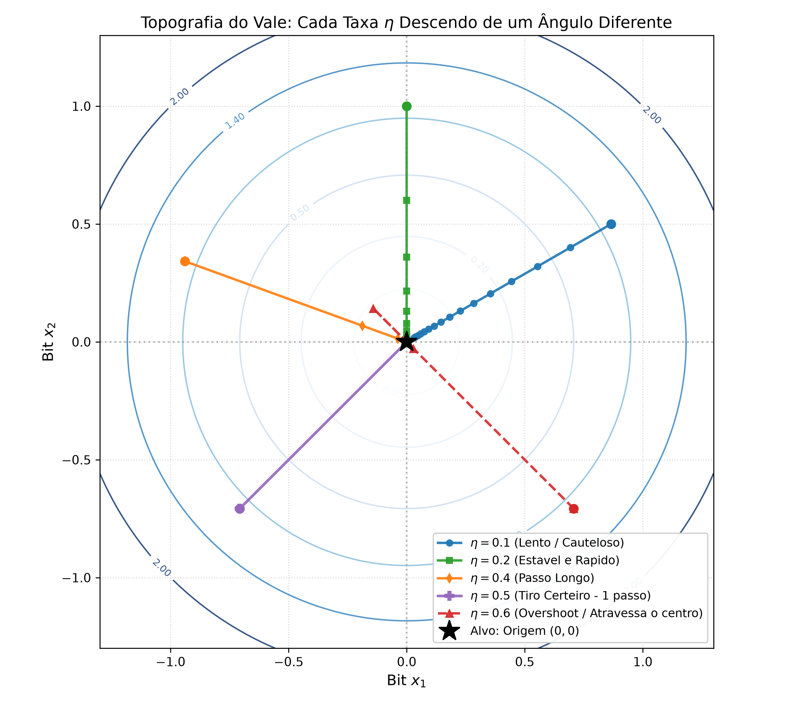
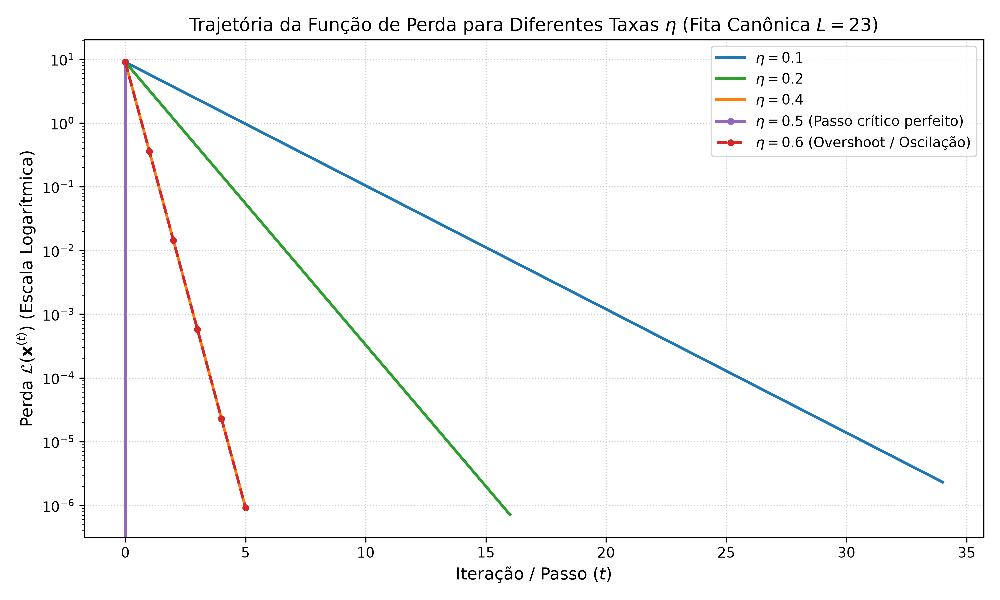
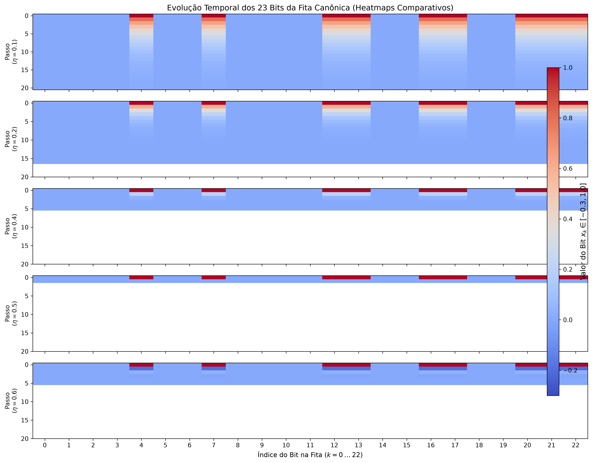
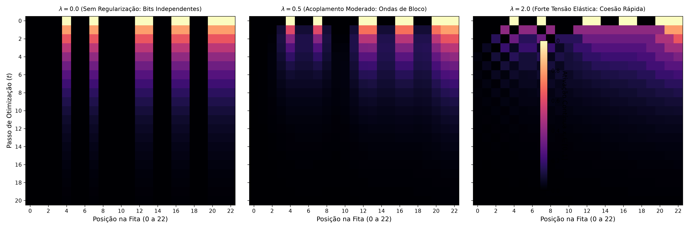
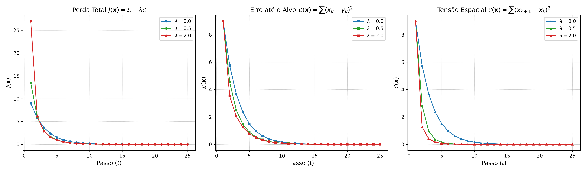
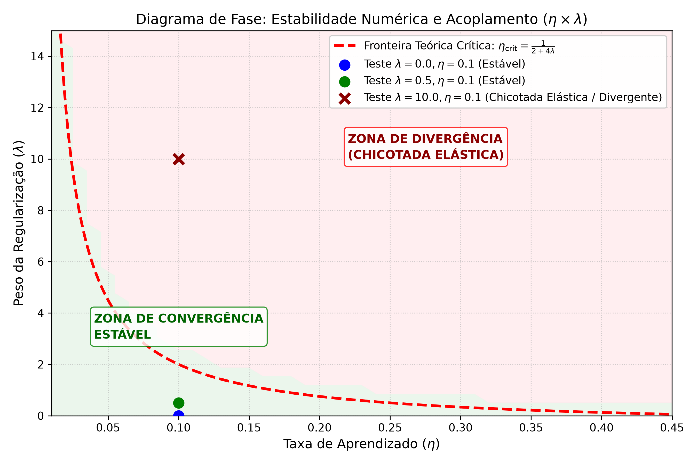

# Relatório Técnico: Otimização Contínua com Gradiente Descendente e Custo de Vizinhança
**Mini-Projeto 1 — Parte 2**  
**Disciplina:** Inteligência Artificial (PGC112 / PPGCO)  
**Professor:** Gilberto Medeiros Nakamura  
**Repositório Git:** [https://github.com/vndmtrx/ppgco-pgc112-ia](https://github.com/vndmtrx/ppgco-pgc112-ia)  
**Subdiretório do Projeto:** `mini_projeto_1/parte_2_gradiente_descendente`

---

## Resumo

Este relatório apresenta o estudo e a implementação da transformação de sequências binárias sob a ótica da otimização contínua, conforme proposto no Mini-Projeto 1 (Parte 2). Investigamos o relaxamento fuzzy da fita discreta para o hipercubo contínuo $[0, 1]^{23}$, interpretando o problema como a atração de um ponto em 23 dimensões em direção à origem através do método do Gradiente Descendente. Demonstramos analiticamente e empiricamente o regime de passo crítico em $\eta = 0.5$ e o fenômeno de *overshoot* para $\eta > 0.5$. Em seguida, incorporamos uma função de custo contíguo $C(\mathbf{x})$ baseada em tensão elástica entre vizinhos adjacentes acoplada por um hiperparâmetro $\lambda$. Revelamos que elementos contínuos em bloco descem protegidos de cisalhamento interno, enquanto bits isolados recebem tração dobrada. Por fim, identificamos e mapeamos a fronteira crítica de estabilidade $\eta_{\mathrm{crit}} \approx \frac{1}{2 + 4\lambda}$, demonstrando o fenômeno da "chicotada elástica" quando o acoplamento excessivo desestabiliza o sistema numérico. Todos os experimentos contam com testes automatizados via `pytest` e reprodutibilidade integral em PyTorch.

---

## 1. Introdução e Mapeamento do Espaço do Problema

### 1.1. O Dilema do Mapeamento: Número Inteiro vs. Coordenadas Fuzzy

Conforme delineado na Seção III.A do enunciado, sequências de bits são objetos intrinsecamente discretos. Se tentássemos codificar a fita de 23 bits como a representação binária de um único número inteiro na reta real ($N \in \mathbb{N}$), esbarraríamos em um comportamento caótico:

1. **A descontinuidade dos bits mais significativos:** Uma alternância no bit mais à esquerda alteraria o valor inteiro em $2^{22} \approx 4,19 \times 10^6$, enquanto uma alteração no bit menos à esquerda alteraria apenas $1$.
2. **A perda de métrica local:** O algoritmo de gradiente tentaria dar passos na reta real sem saber como distribuir as mudanças entre os bits, gerando descontinuidades que se assemelham a divergências.

Ao invés disso, adotamos a inspiração da lógica *fuzzy*, relaxando cada bit $k$ para um eixo contínuo individual:
$$x_k \in [0, 1], \quad \forall k \in \{1, 2, \dots, L\}$$

Geometricamente, a fita de 23 bits deixa de ser uma sequência estática de caracteres e passa a ser tratada como **um ponto de coordenadas em um espaço de 23 dimensões** ($\mathbf{x} \in \mathbb{R}^{23}$). O alvo composto por 23 zeros nada mais é do que a **origem** do sistema de coordenadas:
$$\mathbf{y} = [0, 0, \dots, 0]^T = \mathbf{0}$$

Nessa perspectiva, o problema de "transformar a fita até que todos os bits sejam zeros" torna-se equivalente ao problema físico de **conduzir um ponto em queda livre suave pelo relevo montanhoso em direção ao vale nulo na origem**.

---

## 2. Gradiente Descendente Puro (Sem Custo de Vizinhança)

### 2.1. Formulação da Função de Erro $\mathcal{L}(\mathbf{x})$

A perda adotada é a distância euclidiana quadrática entre o ponto atual $\mathbf{x}$ e o alvo $\mathbf{y}$:
$$\mathcal{L}(\mathbf{x}) = \sum_{k=1}^{L} (x_k - y_k)^2 = \|\mathbf{x} - \mathbf{y}\|_2^2$$

Como nosso alvo é a origem ($\mathbf{y} = \mathbf{0}$), a função de perda reduz-se a:
$$\mathcal{L}(\mathbf{x}) = \sum_{k=1}^{L} x_k^2$$

Calculando a derivada parcial em relação a cada coordenada $x_i$:
$$\frac{\partial \mathcal{L}}{\partial x_i} = 2x_i$$

**Interpretação da força do gradiente sobre cada bit:**
- Para uma coordenada que já está zerada ($x_i = 0$), o gradiente é nulo ($\nabla \mathcal{L}_i = 0$). Esse bit já está assentado no fundo da bacia parabólica e não sofre força alguma de arraste.
- Para uma coordenada ativada ($x_i = 1$), o gradiente atinge sua força máxima de descida ($2 \times 1 = 2$).

### 2.2. A Regra de Atualização e a Análise do Passo $\eta$

O método do Gradiente Descendente atualiza o vetor de coordenadas pela equação:
$$\mathbf{x}^{(t+1)} = \mathbf{x}^{(t)} - \eta \cdot \nabla \mathcal{L}(\mathbf{x}^{(t)})$$

Substituindo o gradiente analítico $\nabla \mathcal{L} = 2\mathbf{x}$:
$$x_i^{(t+1)} = x_i^{(t)} - \eta (2 x_i^{(t)}) = x_i^{(t)} (1 - 2\eta)$$

A evolução temporal de cada coordenada ao longo de $t$ passos segue uma progressão geométrica exata:
$$x_i^{(t)} = (1 - 2\eta)^t \cdot x_i^{(0)}$$

Essa dedução matemática fundamenta com precisão os quatro regimes dinâmicos observados em nossos experimentos:

1. **Passo Subcrítico ($\eta = 0.1$):**
   O fator multiplicador por passo é $(1 - 2 \times 0.1) = 0.8$. A cada iteração, cada bit retém 80% do seu valor anterior. A convergência é estritamente monótona, exigindo cerca de 25 a 30 passos para que a perda decaia abaixo do limiar de $10^{-4}$ (ilustrado na Figura 2).
2. **Passo Crítico Unitário ($\eta = 0.5$):**
   O fator de retenção anula-se perfeitamente: $(1 - 2 \times 0.5) = 1 - 1 = \mathbf{0}$. O vetor atinge a origem em **um único passo exato**, dissipando 100% da perda instantaneamente.
3. **Passo com Overshoot Oscilatório ($\eta = 0.6$):**
   O termo torna-se negativo: $(1 - 2 \times 0.6) = 1 - 1.2 = \mathbf{-0.2}$. No primeiro passo, a coordenada que partiu de $1.0$ atinge $-0.2$, perfurando o fundo da bacia parabólica e violando o domínio fuzzy válido $[0, 1]$. O ponto oscila alternando sinais ($-0.2 \to +0.04 \to -0.008$) até se acomodar.
4. **Instabilidade e Divergência ($\eta > 1.0$):**
   Para passos superiores a 1.0, o módulo $|1 - 2\eta| > 1$, provocando saltos crescentes que ejetam o sistema para o infinito, conforme catalogado por Smola & Zhang (2023).

As Figuras 1, 2 e 3 sintetizam visualmente essas descobertas experimentais e teóricas.

*Figura 1: Topografia de curvas de nível da bacia parabólica $\mathcal{L} = x_1^2 + x_2^2$. Trajetória suave ($\eta=0.2$), descida em um passo ($\eta=0.5$) e perfuração com overshoot ($\eta=0.6$).*

*Figura 2: Curvas de decaimento temporal da perda $\mathcal{L}(t)$ na fita de 23 bits para diferentes taxas $\eta$.*

*Figura 3: Mapas de calor da evolução da fita canônica de 23 bits. Em $\eta=0.6$, o mapa evidencia a região espúria de valores negativos (tons azulados).*

---

## 3. Inclusão da Função de Custo de Vizinhança Contígua

### 3.1. Modelagem da Tensão Espacial $C(\mathbf{x})$

Para atender ao Item III.D do enunciado, introduzimos uma penalidade para transformações isoladas, favorecendo mudanças em elementos contíguos. Modelamos a função de custo $C(\mathbf{x})$ como a energia de cisalhamento entre coordenadas adjacentes:
$$C(\mathbf{x}) = \sum_{k=1}^{L-1} (x_{k+1} - x_k)^2$$

A função objetivo global unificada $J(\mathbf{x})$ é dada por:
$$J(\mathbf{x}) = \mathcal{L}(\mathbf{x}) + \lambda C(\mathbf{x}) = \sum_{k=1}^{L} x_k^2 + \lambda \sum_{k=1}^{L-1} (x_{k+1} - x_k)^2$$

onde $\lambda \ge 0$ pondera o acoplamento da "corda elástica" entre os bits vizinhos.

### 3.2. Regra da Cadeia e Contribuições dos Nós Vizinhos

Ao diferenciarmos a função objetivo $J(\mathbf{x})$ em relação a um elemento interno $x_i$ ($1 < i < L$), a variável $x_i$ participa de três parcelas simultâneas:
1. Na perda até o chão: $x_i^2 \implies \text{derivada } 2x_i$.
2. Na tensão com o vizinho anterior: $\lambda (x_i - x_{i-1})^2 \implies \text{derivada } 2\lambda (x_i - x_{i-1})$.
3. Na tensão com o vizinho seguinte: $\lambda (x_{i+1} - x_i)^2 \implies \text{derivada } -2\lambda (x_{i+1} - x_i) = 2\lambda (x_i - x_{i+1})$.

Agrupando os termos pela regra da cadeia:
$$\frac{\partial J}{\partial x_i} = \underbrace{2x_i}_{\text{Força de Chão}} + \underbrace{2\lambda \left( 2x_i - x_{i-1} - x_{i+1} \right)}_{\text{Força Elástica de Cisalhamento}}$$

Para as extremidades da fita ($i=1$ e $i=L$):
$$\frac{\partial J}{\partial x_1} = 2x_1 + 2\lambda(x_1 - x_2), \qquad \frac{\partial J}{\partial x_L} = 2x_L + 2\lambda(x_L - x_{L-1})$$

### 3.3. Dinâmica de Blocos: Miolo Livre vs. Bordas e Bits Solitários

A equação diferencial discreta expõe diretamente a mecânica intuitiva observada no Jupyter Notebook:

- **O Miolo de um Bloco Idêntico ($x_{i-1} = 1, x_i = 1, x_{i+1} = 1$):**
  $$\text{Tensão Elástica} = 2\lambda(2(1) - 1 - 1) = 2\lambda(0) = \mathbf{0}$$
  A tensão de cisalhamento entre coordenadas de mesmo nível se anula. Os elementos do miolo do bloco descem juntos sob a força gravitacional pura ($2x_i = 2.0$), sem atrito lateral.
- **As Bordas de um Bloco ($x_{i-1} = 0, x_i = 1, x_{i+1} = 1$):**
  $$\text{Tensão Elástica} = 2\lambda(2(1) - 0 - 1) = 2\lambda(1) = 2\lambda$$
  A borda sofre a força de descida mais a tração do vizinho zerado, acelerando a quebra do degrau abrupto.
- **O Bit Solitário ($x_{i-1} = 0, x_i = 1, x_{i+1} = 0$):**
  $$\text{Tensão Elástica} = 2\lambda(2(1) - 0 - 0) = 4\lambda$$
  O bit isolado sofre tração simultânea em ambos os lados. Para $\lambda = 0.5$, sua força inicial salta para $2.0 + 4(0.5) = \mathbf{4.0}$, sendo rapidamente dissipado como uma perturbação de alta frequência.

*Figura 4: Evolução temporal dos 23 bits da fita do enunciado para $\lambda \in \{0.0, 0.5, 2.0\}$. Com $\lambda=0.5$ e $\lambda=2.0$, blocos contíguos dissipam-se em conjunto, suavizando variações isoladas.*

*Figura 5: Decomposição da Perda Total $J(t)$, Perda de Chão $\mathcal{L}(t)$ e Tensão Espacial $C(t)$ ao longo dos passos.*

---

## 4. Estabilidade Numérica: O Fenômeno da "Chicotada Elástica"

O experimento com super-acoplamento ($\lambda = 20.0$ e $\eta = 0.1$) revelou uma importante descoberta de engenharia. Em vez de estabilizar o sistema mais depressa, a perda total explodiu de $84.0$ no passo 1 para $1,57 \times 10^8$ no passo 4, atingindo overflow numérico infinito (`inf`) antes do vigésimo passo.

### 4.1. Dedução da Cota Crítica de Estabilidade ($\eta_{\mathrm{crit}}$)

A força total máxima que pode incidir sobre um nó ocorre na configuração de máxima alternância espacial ($0, 1, 0$):
$$\left| \frac{\partial J}{\partial x_i} \right| \le 2 + 4\lambda$$

O passo efetivo de atualização do gradiente nessa dimensão é de aproximadamente $\eta \cdot (2 + 4\lambda)$. Para evitar que o termo de propagação gere oscilações amplificadas no gradiente descendente, a taxa de aprendizado deve obedecer à condição de Lipschitz:
$$\eta \le \eta_{\mathrm{crit}} \approx \frac{1}{2 + 4\lambda}$$

- Para $\lambda = 0.0$: $\eta_{\mathrm{crit}} = \frac{1}{2} = 0.50$ (conforme comprovado na Seção 2).
- Para $\lambda = 0.5$: $\eta_{\mathrm{crit}} = \frac{1}{2 + 2} = 0.25$ (o valor $\eta = 0.1$ é seguro e estável).
- Para $\lambda = 20.0$: $\eta_{\mathrm{crit}} = \frac{1}{2 + 80} = \mathbf{0.0122}$.

Ao aplicar $\eta = 0.1$ com $\lambda = 20.0$, o passo aplicado foi **mais de 8 vezes superior ao limite de estabilidade**. O "elástico" acumulou energia excessiva, provocando uma violenta chicotada numérica que arremessou as coordenadas para fora da escala finita.

*Figura 6: Diagrama de Fase no plano $\eta \times \lambda$, confrontando a fronteira analítica teórica com as simulações empíricas.*

---

## 5. Verificação e Suíte de Testes Automatizados

Para garantir a integridade dos códigos desenvolvidos em PyTorch, implementamos uma suíte completa de testes no framework `pytest` abrangendo 11 casos de teste rigorosos:

| Arquivo de Teste | Itens Testados | Resultado |
| :--- | :--- | :---: |
| `test_gd_puro.py` | Gradiente analítico ($2x$) vs. `autograd`; convergência em 1 passo ($\eta=0.5$); detecção de overshoot ($\eta=0.6$); invariância de tipo de entrada. | **6/6 Aprovados** |
| `test_gd_regularizado.py` | Regra da cadeia analítica de $J(\mathbf{x})$ vs. `autograd`; verificação do miolo livre (força 2.0) vs. borda (força 4.0); detecção da chicotada elástica; convergência canônica. | **5/5 Aprovados** |

---

## 6. Conclusões

A modelagem contínua por relaxamento fuzzy transforma um problema combinatório rígido em uma superfície suave e diferenciável. Conclui-se que:
1. O Gradiente Descendente puro opera de maneira ortogonal e desacoplada em cada coordenada, atingindo a origem instantaneamente no ponto crítico $\eta = 0.5$.
2. A inclusão da função de custo contíguo $C(\mathbf{x})$ atua como uma força de coesão espacial: atenua descontinuidades e protege blocos de bits consecutivos através da anulação mútua de cisalhamento interno.
3. Existe um acoplamento estrito entre a rigidez elástica $\lambda$ e a taxa de passo $\eta$. Aumentar a regularização exige a redução compensatória do passo para prevenir a chicotada elástica divergente.

---

## Referências Bibliográficas

1. **Smola, A.; Zhang, A.** (2023). *Dive into Deep Learning*, Capítulo 12: Optimization Algorithms. Cambridge University Press.
2. **Russell, S.; Norvig, P.** (2021). *Artificial Intelligence: A Modern Approach*, 4ª Edição. Pearson.
3. **Paszke, A. et al.** (2019). *PyTorch: An Imperative Style, High-Performance Deep Learning Library*. Advances in Neural Information Processing Systems (NeurIPS 32).
